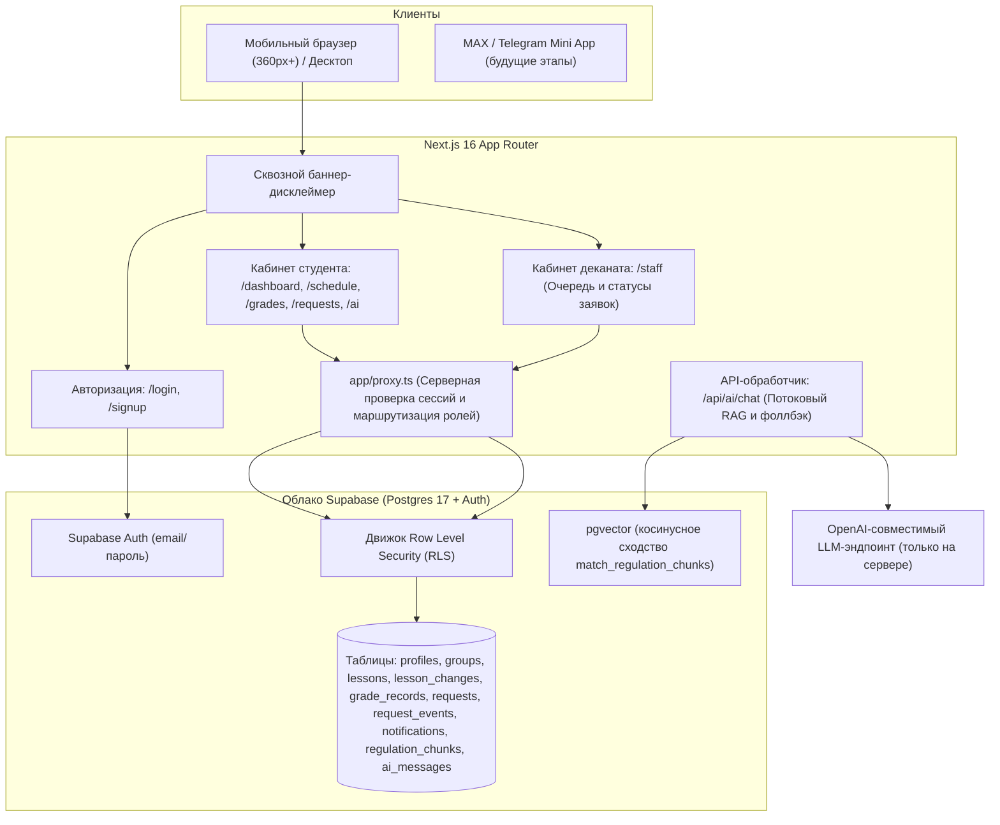

# Архитектура системы — Цифровой деканат

## 1. Схема движения данных и компонентов

## 2. Границы сервисов и зоны ответственности

| Подсистема | Технологический стек | Зона ответственности |
| :--- | :--- | :--- |
| **Клиентская оболочка** | Next.js 16 (App Router), Tailwind CSS v4, shadcn/ui | Реактивный интерфейс, адаптированный под экраны от 360px, нижняя панель навигации, ролевые макеты страниц. |
| **Управление сессиями и прокси** | `app/proxy.ts`, `@supabase/ssr` | Извлечение и валидация cookies сессии на сервере, проверка роли пользователя, перенаправление на `/login` или `/staff`. |
| **База данных и безопасность** | Supabase Postgres 17, политики RLS | Полная изоляция данных студентов на уровне строк, атомарные транзакции, векторный поиск нормативных документов через `pgvector`. |
| **Аутентификация** | Supabase Auth (GoTrue) | Безопасное хеширование паролей, выпуск и обновление JWT-токенов доступа. |
| **Регуляторный AI-ассистент** | Серверный роут (`/api/ai/chat`), pgvector | Ответы на вопросы строго по вымышленным университетским регламентам, цитирование статей и оффлайн-эвристика при отсутствии API-ключа. |

## 3. Журнал архитектурных решений (ADR)

### ADR-001: Выбор облачного Supabase Cloud вместо самостоятельного хостинга
- **Дата**: 10 ноября 2026
- **Контекст**: Конкурсному прототипу требуется стабильная инфраструктура, доступная из РФ без VPN вплоть до окончания оценки жюри (28 ноября 2026). Система требует Postgres 17, сервис аутентификации и расширение `pgvector`.
- **Решение**: Использовать бесплатный облачный тариф Supabase Cloud с периодическим keep-alive запросом вместо самостоятельного поднятия Docker-контейнеров на арендованном VPS.
- **Рассмотренные альтернативы**:
  1. *Docker на личном сервере*: Высокие операционные издержки, необходимость ручной настройки SSL-сертификатов, риск сбоев в период оценивания.
  2. *SQLite / Turso*: Отсутствие встроенного векторного поиска по размерности 1536 и нативной интеграции с Supabase Auth.
- **Последствия**: Отсутствие необходимости администрировать серверную инфраструктуру, надежный RLS «из коробки», удобный веб-интерфейс для демонстрации данных жюри конкурса.
