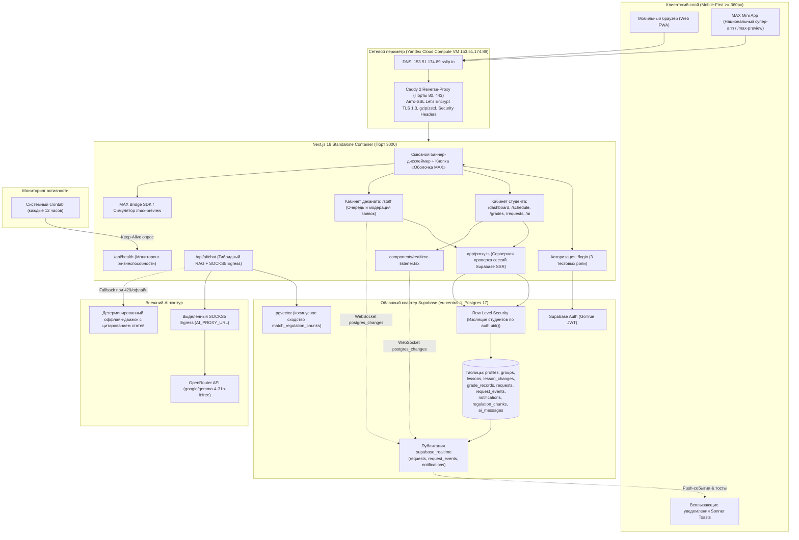

# Архитектура системы — Цифровой деканат (Digital Deanery)

## 1. Схема движения данных и топология развертывания

---

## 2. Границы сервисов и зоны ответственности

| Подсистема | Технологический стек | Зона ответственности |
| :--- | :--- | :--- |
| **Сетевой Ingress** | Caddy 2, Let's Encrypt ACME, `sslip.io` | Прием входящих HTTP/HTTPS соединений, автоматическая генерация и ротация TLS-сертификата, HTTP/2, сжатие gzip/zstd, заголовки безопасности (`X-Frame-Options: DENY`, `X-Content-Type-Options: nosniff`). |
| **Клиентская оболочка** | Next.js 16 (App Router), Tailwind CSS v4, shadcn/ui | Реактивный интерфейс, адаптированный под экраны от 360px, нижняя панель навигации, ролевые макеты страниц, сквозной баннер-дисклеймер. |
| **Оболочка супер-аппа MAX** | MAX Bridge SDK, Safe Area Insets, `/max-preview` | Поддержка запуска веб-приложения внутри национальной платформы MAX, обработка системной кнопки «Назад», раскрытие на полный экран, интерактивный веб-симулятор для жюри. |
| **Серверный рантайм** | Docker multi-stage (Node.js 22 Alpine, non-root) | Next.js в режиме `output: standalone`, потребление RAM ~220 МБ, работа под непривилегированным пользователем `nextjs:nodejs` (UID 1001). |
| **Управление сессиями и прокси** | `app/proxy.ts`, `@supabase/ssr` | Извлечение и валидация cookies сессии на сервере, проверка роли пользователя, безопасный редирект на `/login` или `/staff`. |
| **База данных и безопасность** | Supabase Postgres 17, политики RLS | Полная изоляция данных студентов на уровне строк (`auth.uid()`), атомарные транзакции, семантический поиск нормативных документов через `pgvector`. |
| **Аутентификация** | Supabase Auth (GoTrue) | Безопасное хеширование паролей, выпуск и обновление JWT-токенов доступа для 3 тестовых ролей. |
| **Регуляторный AI-ассистент** | Серверный роут (`/api/ai/chat`), pgvector, SOCKS5 | Ответы на вопросы строго по 40 вымышленным университетским регламентам, цитирование статей, обращение к OpenRouter через SOCKS5-прокси и оффлайн-фоллбэк. |

---

## 3. Журнал архитектурных решений (ADR)

### ADR-001: Выбор облачного Supabase Cloud вместо самостоятельного хостинга базы
- **Дата**: 10 ноября 2026
- **Контекст**: Конкурсному прототипу требуется стабильная инфраструктура, доступная из РФ без VPN вплоть до окончания оценки жюри (28 ноября 2026). Система требует Postgres 17, сервис аутентификации и расширение `pgvector`.
- **Решение**: Использовать облачный тариф Supabase Cloud с периодическим keep-alive запросом вместо самостоятельного поднятия Docker-контейнеров на арендованном VPS.
- **Последствия**: Отсутствие необходимости администрировать серверную СУБД, надежный RLS «из коробки», удобный веб-интерфейс для демонстрации данных жюри конкурса.

### ADR-002: Механизм Keep-Alive для Supabase Free Tier
- **Дата**: 11 ноября 2026 (актуализировано 22.11.2026)
- **Контекст**: Бесплатный тариф Supabase приостанавливает (pause) проекты после 7 дней отсутствия входящих запросов.
- **Решение**: Настроить системный crontab на сервере деплоя (`0 */12 * * *`), который каждые 12 часов опрашивает легковесный эндпоинт `/api/health`, поддерживая постоянную активность базы данных Supabase Cloud до окончания конкурса.

### ADR-003: Отказ от REG.облака и выбор Yandex Cloud Compute VM с Caddy Auto-SSL
- **Дата**: 22 ноября 2026
- **Контекст**: По результатам Deep Research от 22.11.2026 выявлено, что Free Tier REG.облака был досрочно закрыт провайдером 17.11.2026. Зарубежные PaaS (Vercel, Netlify, Render) блокируются ТСПУ/РКН на сетях операторов РФ.
- **Решение**: Развернуть суверенный сервер на **Yandex Cloud Compute VM** (Москва, зона `ru-central1-d`, 2 vCPU, 2 ГБ RAM, 10 ГБ SSD, статический публичный IPv4: `153.51.174.89`) с использованием активного стартового гранта 4 000 ₽ на 60 дней.
- **Сетевой Ingress**: Использование бесплатного wildcard-домена `153.51.174.89.sslip.io` в связке с реверс-прокси **Caddy 2**, который автоматически получает и обновляет доверенный TLS-сертификат Let's Encrypt. Это обеспечивает нулевые финансовые затраты на домен и мгновенную доступность по HTTPS.

### ADR-004: Селективное SOCKS5-проксирование исходящих запросов к OpenRouter
- **Дата**: 11 ноября 2026
- **Контекст**: API OpenRouter (`openrouter.ai`) заблокирован для прямого доступа из подсетей российских провайдеров.
- **Решение**: Использовать библиотеку `socks-proxy-agent` в роуте `/api/ai/chat`. Если в окружении задана переменная `AI_PROXY_URL`, запрос к модели `google/gemma-4-31b-it:free` направляется через SOCKS5-прокси. При возникновении 429 или сетевой ошибки срабатывает автоматический откат на резервную модель и встроенный оффлайн-движок.

### ADR-005: Приоритет интеграции MAX Mini App (супер-апп) над Telegram Mini App
- **Дата**: 22 ноября 2026
- **Контекст**: В рамках регламента конкурса МГИМО концепция «Цифрового деканата» оценивается по смелости идеи и глубине интеграции в государственные и образовательные экосистемы.
- **Решение**: Реализовать поддержку национальной платформы **MAX (Госуслуги / MAX)** по схеме Dual-Mode (нативный `MAX Bridge SDK` + веб-симулятор `/max-preview`). Тикет Telegram Mini App переведен в статус `SKIPPED`, так как он является вторичным и менее релевантным академическому контексту РФ, чем национальный супер-апп.

### ADR-006: Интеграция Supabase Realtime (postgres_changes) и тостов Sonner для очередей самообслуживания
- **Дата**: 22 ноября 2026
- **Контекст**: В архаичных студенческих системах статус заявки требует регулярной ручной перезагрузки страниц (F5). Для конкурсного прототипа требуется моментальный отклик интерфейса как у студента, так и у сотрудника деканата.
- **Решение**: Включить публикацию `supabase_realtime` для таблиц `requests`, `request_events`, `notifications` в связке со строгим RLS и `REPLICA IDENTITY FULL`. Использовать библиотеку `sonner` для ненавязчивых всплывающих уведомлений, а в очереди модерации (`/staff`) при поступлении новых заявок применять кратковременную пульсирующую подсветку (`ring-2 ring-primary bg-primary/5`).
- **Последствия**: Задержка обновления статусов между параллельными сессиями составляет менее 1.5 секунд; соблюдается строгая безопасность и нулевая утечка чужих данных через сокеты.
