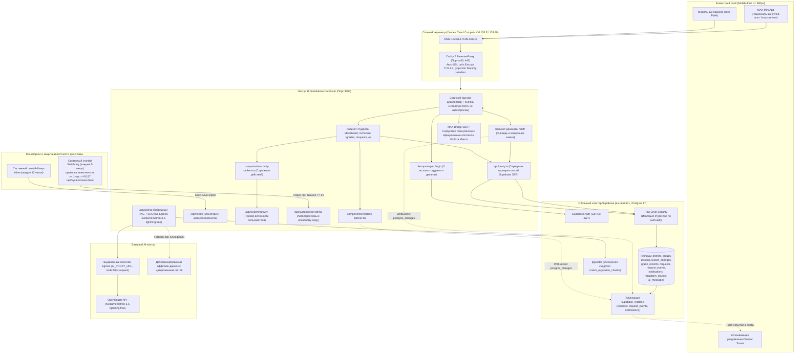

# Архитектура системы — Цифровой деканат (Digital Deanery)

## 1. Схема движения данных и топология развертывания

---

## 2. Границы сервисов и зоны ответственности

| Подсистема | Технологический стек | Зона ответственности |
| :--- | :--- | :--- |
| **Сетевой Ingress** | Caddy 2, Let's Encrypt ACME, `sslip.io` | Прием входящих HTTP/HTTPS соединений, автоматическая генерация и ротация TLS-сертификата, HTTP/2, сжатие gzip/zstd, заголовки безопасности (`X-Frame-Options: DENY`, `X-Content-Type-Options: nosniff`). |
| **Клиентская оболочка** | Next.js 16 (App Router), Tailwind CSS v4, shadcn/ui | Реактивный интерфейс, адаптированный под экраны от 360px, нижняя панель навигации, ролевые макеты страниц, сквозной баннер-дисклеймер. |
| **Оболочка супер-аппа MAX** | MAX Bridge SDK, Safe Area Insets, `/max-preview` | Поддержка запуска веб-приложения внутри национальной платформы MAX, обработка системной кнопки «Назад», раскрытие на полный экран, интерактивный веб-симулятор для жюри. |
| **Серверный рантайм** | Docker multi-stage (Node.js 22 Alpine, non-root) | Next.js в режиме `output: standalone`, потребление RAM ~220 МБ, работа под непривилегированным пользователем `nextjs:nodejs` (UID 1001). |
| **Управление сессиями и прокси** | `app/proxy.ts`, `@supabase/ssr` | Извлечение и валидация cookies сессии на сервере, проверка роли пользователя, безопасный редирект на `/login` или `/staff`. |
| **База данных и безопасность** | Supabase Postgres 17, политики RLS | Полная изоляция данных студентов на уровне строк (`auth.uid()`), атомарные транзакции, семантический поиск нормативных документов через `pgvector`. |
| **Аутентификация** | Supabase Auth (GoTrue) | Безопасное хеширование паролей, выпуск и обновление JWT-токенов доступа для 3 тестовых ролей. |
| **Генератор справок и документов** | `@react-pdf/renderer` v4.9.0, Noto Sans TTF | Формирование официальных справок формата A4 с гербовой печатью, штампом усиленной ЭЦП, юридическим текстом и серверной защитой от IDOR (`/api/requests/[id]/certificate`). |
| **Регуляторный AI-ассистент** | Серверный роут (`/api/ai/chat`), pgvector, SOCKS5 | Ответы на вопросы строго по 40 вымышленным университетским регламентам, цитирование статей, обращение к OpenRouter через SOCKS5-прокси, академический guardrail от оффтопа и оффлайн-фоллбэк. |
| **PWA & Мобильный слой** | App Router Manifest (`app/manifest.ts`), standalone | Поддержка PWA (Progressive Web App) с автономным манифестом `/manifest.webmanifest`, палитрой `#0f172a` и оптимизированными иконками. |
| **Дизайн-система и микро-анимации** | Tailwind CSS v4, `globals.css`, SVG | Просторные карточки `p-5 sm:p-6`, аппаратные анимации `transform` и `opacity` (hover lift, `active:scale-[0.96]`, `.animate-fade-in-up`), поддержка `prefers-reduced-motion`, премиальный векторный SVG-фавикон (`public/favicon.svg`, `app/icon.svg`). |

---

## 3. Журнал архитектурных решений (ADR)

### ADR-001: Выбор облачного Supabase Cloud вместо самостоятельного хостинга базы
- **Дата**: 10 ноября 2026
- **Контекст**: Конкурсному прототипу требуется стабильная инфраструктура, доступная из РФ без VPN вплоть до окончания оценки жюри (28 ноября 2026). Система требует Postgres 17, сервис аутентификации и расширение `pgvector`.
- **Решение**: Использовать облачный тариф Supabase Cloud с периодическим keep-alive запросом вместо самостоятельного поднятия Docker-контейнеров на арендованном VPS.
- **Последствия**: Отсутствие необходимости администрировать серверную СУБД, надежный RLS «из коробки», удобный веб-интерфейс для демонстрации данных жюри конкурса.

### ADR-002: Механизм Keep-Alive для Supabase Free Tier
- **Дата**: 11 ноября 2026 (актуализировано 22.11.2026)
- **Контекст**: Бесплатный тариф Supabase приостанавливает (pause) проекты после 7 дней отсутствия входящих запросов.
- **Решение**: Настроить системный crontab на сервере деплоя (`0 */12 * * *`), который каждые 12 часов опрашивает легковесный эндпоинт `/api/health`, поддерживая постоянную активность базы данных Supabase Cloud до окончания конкурса.

### ADR-003: Отказ от REG.облака и выбор Yandex Cloud Compute VM с Caddy Auto-SSL
- **Дата**: 22 ноября 2026
- **Контекст**: По результатам Deep Research от 22.11.2026 выявлено, что Free Tier REG.облака был досрочно закрыт провайдером 17.11.2026. Зарубежные PaaS (Vercel, Netlify, Render) блокируются ТСПУ/РКН на сетях операторов РФ.
- **Решение**: Развернуть суверенный сервер на **Yandex Cloud Compute VM** (Москва, зона `ru-central1-d`, 2 vCPU, 2 ГБ RAM, 10 ГБ SSD, статический публичный IPv4: `153.51.174.89`) с использованием активного стартового гранта 4 000 ₽ на 60 дней.
- **Сетевой Ingress**: Использование бесплатного wildcard-домена `153.51.174.89.sslip.io` в связке с реверс-прокси **Caddy 2**, который автоматически получает и обновляет доверенный TLS-сертификат Let's Encrypt. Это обеспечивает нулевые финансовые затраты на домен и мгновенную доступность по HTTPS.

### ADR-004: Селективное SOCKS5-проксирование исходящих запросов к OpenRouter
- **Дата**: 11 ноября 2026
- **Контекст**: API OpenRouter (`openrouter.ai`) заблокирован для прямого доступа из подсетей российских провайдеров.
- **Решение**: Использовать библиотеку `socks-proxy-agent` в роуте `/api/ai/chat`. Если в окружении задана переменная `AI_PROXY_URL`, запрос к модели `google/gemma-4-31b-it:free` направляется через SOCKS5-прокси. При возникновении 429 или сетевой ошибки срабатывает автоматический откат на резервную модель и встроенный оффлайн-движок.

### ADR-005: Приоритет интеграции MAX Mini App (супер-апп) над Telegram Mini App
- **Дата**: 22 ноября 2026
- **Контекст**: В рамках регламента конкурса МГИМО концепция «Цифрового деканата» оценивается по смелости идеи и глубине интеграции в государственные и образовательные экосистемы.
- **Решение**: Реализовать поддержку национальной платформы **MAX (Госуслуги / MAX)** по схеме Dual-Mode (нативный `MAX Bridge SDK` + веб-симулятор `/max-preview`). Тикет Telegram Mini App переведен в статус `SKIPPED`, так как он является вторичным и менее релевантным академическому контексту РФ, чем национальный супер-апп.

### ADR-006: Интеграция Supabase Realtime (postgres_changes) и тостов Sonner для очередей самообслуживания
- **Дата**: 22 ноября 2026
- **Контекст**: В архаичных студенческих системах статус заявки требует регулярной ручной перезагрузки страниц (F5). Для конкурсного прототипа требуется моментальный отклик интерфейса как у студента, так и у сотрудника деканата.
- **Решение**: Включить публикацию `supabase_realtime` для таблиц `requests`, `request_events`, `notifications` в связке со строгим RLS и `REPLICA IDENTITY FULL`. Использовать библиотеку `sonner` для ненавязчивых всплывающих уведомлений, а в очереди модерации (`/staff`) при поступлении новых заявок применять кратковременную пульсирующую подсветку (`ring-2 ring-primary bg-primary/5`).
- **Последствия**: Задержка обновления статусов между параллельными сессиями составляет менее 1.5 секунд; соблюдается строгая безопасность и нулевая утечка чужих данных через сокеты.

### ADR-007: Генерация справок на @react-pdf/renderer с локальными шрифтами Noto Sans и защитой от IDOR
- **Дата**: 22 ноября 2026
- **Контекст**: Студенческий портал самообслуживания требует выдачи достоверных электронных справок об обучении. Использование клиентских генераторов HTML-to-Canvas приводит к кракозябрам в кириллице, расплывчатой векторной печати и риску сбоев на мобильных устройствах. Также критически необходима защита от подмены ID заявки (IDOR).
- **Решение**: Использовать библиотеку `@react-pdf/renderer` v4.9.0 с локальной регистрацией шрифтов `NotoSans-Regular.ttf` и `NotoSans-Bold.ttf` из `public/fonts/`. Выдавать PDF через защищенный серверный эндпоинт `/api/requests/[id]/certificate`, строго проверяющий права в сессии Supabase (`role === 'staff'` либо совпадение `student_id`). В интерфейсе предпросмотра использовать модальное окно с непрозрачным контрастным футером и сочной кнопкой скачивания.
- **Последствия**: 100% чистый рендеринг кириллицы на любой ОС и в Docker-контейнере, нулевые внешние шрифтовые зависимости, строгая защита от несанкционированного доступа к чужим документам.

### ADR-008: Подлинное расписание ИГУ, интерактивная шторка ДЗ, нативный PWA и академические AI-гардрейлы
- **Дата**: 22 ноября 2026
- **Контекст**: Студенческий интерфейс требует не просто абстрактного списка пар, а аутентичного учебного контекста с домашними заданиями, баллами БРС и контактами преподавателей. Также требовалось устранить паразитные десктопные скроллбары (Single-Scrollbar Policy), внедрить поддержку PWA без сторонних тяжелых библиотек и защитить академического AI-ассистента от оффтопа (рецепты, погода, развлечения).
- **Решение**:
  1. Выполнен парсинг подлинного расписания 1 курса Международных отношений ИГУ (группа 07131-ДБ) из проверенного файла `Raspisanie_2026-2027_41_03_05_Mezhdunarodnye_otnoshenia (2).xlsx` в типизированный SSoT-модуль `lib/schedule-data.ts` с мгновенным переключением на группу `ЦД-23-1 • IT`.
  2. Разработана доступная интерактивная шторка дисциплины (`components/subject-sheet.tsx`) с детализацией аудиторий, ссылками на образовательную платформу Educa, дедлайнами ДЗ, контактами преподавателей и шкалой БРС.
  3. Внедрен нативный App Router Web App Manifest (`app/manifest.ts`) со статическим маршрутом `/manifest.webmanifest`, иконками 192/512 и поддержкой режима standalone.
  4. Ликвидированы паразитные вертикальные скроллбары (замена фиксированных `pb-20` на адаптивные `md:pb-6` и сжатие отступов экрана входа). Бейджи приведены к стандарту контрастности WCAG AA ($\ge 4.5:1$).
  5. Реализован двухуровневый академический guardrail в `/api/ai/chat` (детерминированная блокировка оффтопа + системный промпт) и встроен чистый парсер Markdown без сырых звездочек с сохранением сессии в `localStorage`.
- **Последствия**: Аутентичный студенческий опыт, полное соответствие эргономическим и регуляторным стандартам, высокая отказоустойчивость и безопасность.

### ADR-009: Строгая изоляция профилей студентов (SSoT), транспорт node:https для SOCKS5 AI и автосброс демо-данных
- **Дата**: 23 ноября 2026
- **Контекст**: При тестировании сценариев с разными студентами обнаружилось смешивание зачеток (у студентки Кузнецовой с долгом отображался отличный балл 4.8 Смирнова), залипание шапки в оболочке MAX при прокрутке, сброс SOCKS-агента в Node.js 18+ native fetch (приводящий к HTTP 403 на OpenRouter), а также необходимость автоматической очистки накапливающихся при демонстрации заявок без сброса базы посреди активного тестирования жюри.
- **Решение**: 
  1. Выделить независимые изолированные наборы данных для каждого студента: Смирнов (ЦД, GPA 4.8, 0 долгов), Кузнецова (ЦД, GPA 3.25, 1 долг по Матанализу с интерактивным симулятором сдачи), Иванова (МО ИГУ, группа 07131-ДБ, GPA 4.67). Привязать расписание строго к группе авторизованного студента без лишних вкладок чужих направлений.
  2. Убрать `sticky top-0` у шапки и дисклеймера для плавного скролла контента без паразитных наложений и висящих границ.
  3. Переписать сетевой транспорт роута `/api/ai/chat` с `fetch` на `node:https.request` с проксированием через `SocksProxyAgent`, подключить быструю модель `nvidia/nemotron-3.5-lightning:free` с каскадом на `liquid/lfm-3-1.7b:free`.
  4. Внедрить систему автосброса демо-базы: слушатель активности `<ActivityTracker />`, эндпоинт `/api/system/activity`, серверный сброс `/api/system/reset-demo` и крон-вотчдог `scripts/demo-watchdog.sh`, накатывающий эталонный сид ровно через 1 час неактивности после последнего действия пользователя.
- **Последствия**: 100% достоверная демонстрация академических рисков для каждого студента, живой отклик нейросети без оффлайн-заглушек, гарантия чистой базы данных для каждого проверяющего жюри.

### ADR-010: Эргономичный редизайн карточек расписания и оценок, микро-анимации (animate & better-motion) и векторный SVG-фавикон
- **Дата**: 23 ноября 2026
- **Контекст**: Внутренние карточки расписания (`/schedule`) и зачетной книжки (`/grades`) были зажаты в паддинг `p-3.5`, мелкий заголовок `text-xs font-semibold` слипался с бейджами и метаданными, а время в расписании теснилось в углу. Требовалось выровнять визуальный уровень с карточкой «Ближайшая пара» с Главного экрана, добавить упругий тактильный отклик и создать собственный векторный SVG-фавикон высокой четкости.
- **Решение**:
  1. Выполнена переработка карточек расписания: увеличение отступов до `p-5 sm:p-6`, выделение заголовка в `text-base sm:text-lg font-bold`, вынос времени в аккуратный моноширинный бейдж `09:00 – 10:30` с иконкой `Clock` в верхнем правом углу, аккуратное разнесение преподавателя (`User`) и аудитории (`MapPin`), сбалансированный подвал ДЗ/БРС.
  2. Редизайн карточек оценок: `p-5 sm:p-6`, крупное название предмета, контрастный бейдж оценки WCAG AA, сбалансированная нижняя плашка с баллами БРС и единицами ЗЕТ.
  3. Внедрена система аппаратных микро-интеракций по скиллам `animate` и `better-motion`: токены `--ease-out-snappy` и `--ease-out-natural`, класс `.card-interactive` (hover lift `translateY(-2px)`, мягкая тень, click-feedback `active:scale-[0.96]`), плавный fade/slide переход `.animate-fade-in-up` (`180ms ease-out`) при переключении табов дней недели и семестров, кнопки `Button` с каноническим сжатием `active:scale-[0.96]`, поддержка `@media (prefers-reduced-motion: reduce)`.
  4. Создан премиальный векторный SVG-фавикон (`public/favicon.svg`, `app/icon.svg`): академическая шапочка магистра с серебристым рельефом, золотистая кисточка отличника и цифровая искра AI на сапфировом сквиркле с двойным градиентным бордером для контрастной видимости на черных, темных и светлых вкладках.
- **Последствия**: Высокая визуальная культура и просторность интерфейса, устранение эффекта слипания элементов, плавный отклик 60+ FPS без лишних внешних библиотек и брендовая иконка во всех современных браузерах.
