# Введение и концепция проекта

> [!NOTE]
> **Конкурсный контекст**: Проект разработан для всероссийского конкурса **MGIMO × AI Challenge** в рамках трека **Vibe-Coding**. Автор проекта: **Захар** (соло-разработчик).  
> Действующий боевой прототип развернут в Yandex Cloud (Москва): [**https://153.51.174.89.sslip.io**](https://153.51.174.89.sslip.io) (доступен без VPN).

«Цифровой деканат» — это мобильно-ориентированный портал самообслуживания студента, объединяющий в едином интерфейсе расписание занятий, электронную зачётную книжку с предиктивным трекингом сессии, онлайн-заказ юридически значимых справок с квалифицированной ЭЦП деканата и регуляторного AI-ассистента на базе гибридного RAG (`pgvector`).

Проект создан с опорой на парадигму **чистого вайб-кодинга**: 100% рабочего кода платформы сгенерировано автономным ИИ-ассистентом **Gemini 3.8 Flash (High)** под управлением системы оркестрации **AntiGravity 2.0** по многоуровневым системным спецификациям и правилам.

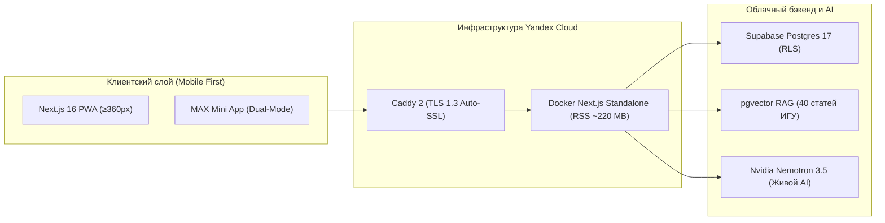

<!-- pagebreak -->

# 1. Проблематика студентов и архитектура разделов

## 1.1. Исследование болей студентов (Интервью и опрос в ИГУ)
Перед началом проектирования был проведен опрос сокурсников и студентов различных направлений Иркутского государственного университета (ИГУ). Исследование выявило системный кризис фрагментации академической среды:

1. **Хаос и «мониторинг стены ВКонтакте»**:  
   Вся оперативная коммуникация деканата исторически сосредоточена в группе ВКонтакте. Студенты жаловались, что им приходится непрерывно мониторить стену группы, пролистывая бесконечную ленту новостей, чтобы не пропустить перенос пары, приказ о стипендии или график пересдач. Единого официального источника правды просто нет.
2. **«Сарафанное радио» и потеря важной информации**:  
   Критические объявления передаются старостам через цепочки бесед, откуда перетекают от одного человека к другому. В результате до рядового студента доходит искаженная информация, либо новость теряется вовсе.
3. **Непрозрачность академического статуса («Где завалы?»)**:  
   Студенты не понимают своего текущего положения в семестре: *«Сколько баллов БРС мне не хватает до допуска?», «Есть ли у меня хвосты?», «Грозит ли мне отчисление?»*. Оценки разбросаны между ведомостями преподавателей, архаичной системой 1С и личными блокнотами.
4. **Бюрократический барьер при заказе справок**:  
   Чтобы получить обычную справку об обучении (для военкомата, налогового вычета или визы), студент вынужден лично идти в часы приема деканата, стоять в очереди и ждать до 5–10 рабочих дней без возможности отследить статус готовности документа.
5. **Отсутствие нормальной мобильной версии**:  
   Официальные порталы вузов спроектированы под десктоп 2010-х годов. На экране смартфона таблицы расписания разъезжаются, а авторизация регулярно сбрасывается.

<!-- pagebreak -->

## 1.2. Обоснование выбора ключевых разделов
На основе опроса было сформировано «золотое ядро» самообслуживания студента, в котором каждая функция доступна максимум за 1–2 касания с мобильного экрана:

| Раздел платформы | Решаемая проблема студента | Ключевая ценность |
| :--- | :--- | :--- |
| **Главный экран (`/dashboard`)** | Нет общего понимания дел | Персонализированный дашборд: индикатор риска отчисления, текущий GPA (4.8), прогресс закрытия зачетных единиц (ЗЕТ), ближайшая пара и лента срочных дедлайнов. |
| **Расписание (`/schedule`)** | Разъезжающиеся таблицы и потеря пар | Адаптивная недельная сетка с бейджами времени, индикатором переноса аудитории и интерактивной шторкой предмета (задания, дедлайны, ссылки на СДО EduKa, пороги БРС). |
| **Зачетная книжка (`/grades`)** | «Где завалы и сколько баллов надо на экзамен?» | Электронная зачетка с прозрачной картиной БРС по дисциплинам и интерактивным калькулятором-симулятором сессии. |
| **Заявки и справки (`/requests`)** | Очереди в деканате и потеря времени | Онлайн-заказ документов, трекинг статуса в реальном времени (подано $\to$ в работе $\to$ готово) и моментальное скачивание официальной PDF-справки с гербовой печатью и ЭЦП. |
| **AI-деканат (`/ai`)** | Поиск ответов в 50-страничных PDF регламентов | Нейросетевой консультант на базе `pgvector`, мгновенно отвечающий на вопросы по стипендиям, пересдачам и академотпуску с обязательной ссылкой на статью регламента. |
| **Очередь деканата (`/staff`)** | Закрытость процессов для сотрудников | Полноценный кабинет сотрудника деканата: модерация входящих заявок в 1 клик с моментальным Realtime-пушем статуса студенту. |

> [!IMPORTANT]
> **Принцип «Единого окна» и мобильной эргономики**:
> Все 6 ключевых разделов спроектированы по стандарту Touch-Target $\ge 44\times 44$ px и оптимизированы для работы на экранах смартфонов от 360 px (iPhone SE) до современных флагманов. Вся критическая информация (статус сессии, ближайшая пара, готовность справки) доступна студенту на первом же экране без необходимости блуждать по меню.

<!-- pagebreak -->

# 2. Полный перечень ИИ-инструментов и сервисов

В разработке проекта применялся строгий стек инструментов вайб-кодинга без распыления на случайные утилиты:

| Инструмент / Сервис | Категория | Роль в проекте и решаемая задача |
| :--- | :--- | :--- |
| **AntiGravity 2.0 (Google DeepMind)** | Agentic IDE & Orchestrator | Центральная среда вайб-кодинга: многоагентная оркестрация, управление файлами, выполнение терминальных команд PowerShell/Bash, запуск тестов Vitest и компиляция документации. |
| **Gemini 3.8 Flash (High)** | Языковая модель (LLM) | **Единая основная модель разработки**: генерация 100% исходного кода Next.js 16 / TypeScript, верстка Tailwind CSS v4, создание движка PDF-справок `@react-pdf/renderer`, отладка SSR-ошибок и адаптивности. |
| **Perplexity Pro** | AI-архитектор & Deep Research | Исследование нормативных регламентов вузов, анализ болей студентов, проектирование архитектурных спецификаций и формулирование суперпромптов в парадигме «Perplexity Space $\to$ AntiGravity Builder». |
| **GLM 5.3 Zcode (в Perplexity)** | Код-ревью & Инженерия | Независимый внешний аудит архитектуры (TICKET-07.6), верификация политик Supabase RLS, стресс-тестирование граничных случаев и валидация безопасности перед релизом. |
| **Nvidia Nemotron-3.5-Lightning** | Production AI API | Открытая языковая модель, подключенная к серверному роуту `/api/ai/chat` через защищенный SOCKS5-эгресс для живого инференса ответов AI-ассистента деканата в продакшене. |
| **Chrome DevTools MCP** | MCP Server | Инструмент автономной автоматизации браузера: реверс-инжиниринг, аудит доступности (WCAG AA), эмуляция мобильных устройств (390x844) и автоматический захват скриншотов с боевого сервера. |
| **Supabase Postgres 17 & MCP** | Backend & Database | Реляционная база данных в облаке: миграции схемы DDL, изоляция данных через Row Level Security (RLS), векторное хранилище `pgvector` для RAG и шина `supabase_realtime`. |
| **Yandex Cloud Compute** | Cloud Infrastructure | Суверенный виртуальный сервер в Москве (2 vCPU, 2 ГБ RAM, 10 ГБ SSD, Ubuntu 24.04 LTS), обеспечивающий стабильную доступность прототипа из РФ без VPN. |
| **Caddy 2 & Docker** | Ingress & Containerization | Multi-stage Docker для автономного Next.js (RSS ~220 МБ) и реверс-прокси Caddy 2 с автоматическим выпуском сертификатов Let's Encrypt TLS 1.3. |
| **Typst 0.15 + Pandoc (`pdf-report-generator`)** | Document Engine | Локальный компилятор отчетов: автоматическая трансформация Markdown-спецификаций в представительский PDF формата А4 с векторными Mermaid-диаграммами. |

<!-- pagebreak -->

## 2.1. Сквозной архитектурный пайплайн разработки

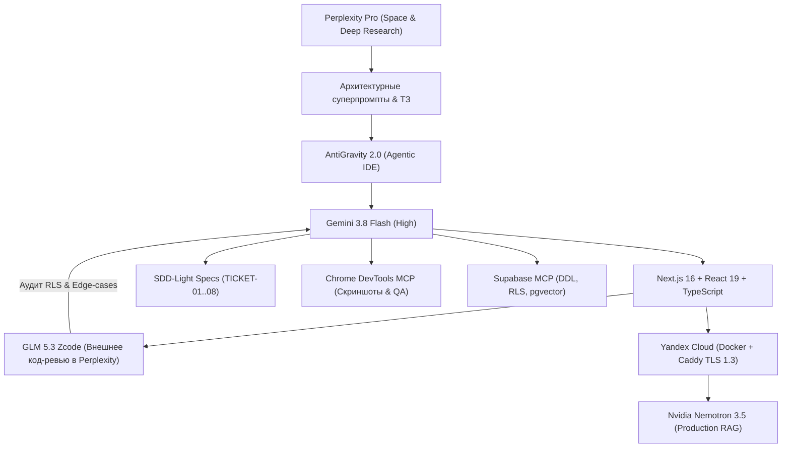

Архитектурная схема иллюстрирует замкнутый цикл инженерной разработки: глубокие нормативные исследования и формирование суперпромптов в Perplexity Space передаются в среду оркестрации AntiGravity 2.0. Модель Gemini 3.8 Flash автономно генерирует код и миграции, внешняя ревью-модель GLM 5.3 Zcode валидирует безопасность RLS, а специализированные MCP-серверы Chrome DevTools и Supabase обеспечивают сквозной контроль качества и фиксацию боевых артефактов.

<!-- pagebreak -->

# 3. Ключевые промпты и культура вайб-кодинга

## 3.1. Многоуровневая архитектура инструкций (Двухуровневый инвариант)
В отличие от хаотичного чат-кодинга, разработка «Цифрового деканата» велась на основе строгой инженерной дисциплины:
- **Глобальные инварианты (`AGENTS.md`)**: неизменяемые правила Solo-Maker (автор строго **Захар**), Zero-Mock Policy (запрет фиктивных данных-заглушек в боевом коде), правила языкового интерфейса (чистый русский язык без канцеляризмов по стандарту `sasha`), Zero-Emoji (строго векторные SVG-иконки).
- **Спецификации тикетов (`specs/TICKET-*.md`)**: каждый функциональный этап формулировался по стандарту **SDD-Light**: *Objective $\to$ Preconditions $\to$ Scope $\to$ Out of scope $\to$ Done-When $\to$ Risks*.
- **Реестр состояния (`docs/STATE.md`)**: единый источник правды (SSoT), отслеживающий статус слоев платформы и историю закрытых тикетов с ротацией в `docs/CHANGELOG.md`.

## 3.2. Эталонные диалоги и промпты по стадиям разработки

### Этап 1: Архитектура базы данных и изоляция студентов (Supabase RLS)
> **Промпт Захара**:
> *«Спроектируй схему базы данных Supabase Postgres 17 для цифрового деканата. Необходимо реализовать 10 таблиц: профили студентов, группы, дисциплины, расписание, оценки БРС, заявки на справки, история событий заявок, регламенты вуза с эмбеддингами pgvector.  
> Главное требование: строжайший Row Level Security (RLS). Студент с `role = 'student'` должен физически иметь доступ на чтение и запись ТОЛЬКО к своим собственным данным (`auth.uid() = student_id`). Доступ к чужим профилям или чужим заявкам должен пресекаться ядром СУБД с ошибкой 403, даже если студент вручную подставит чужой UUID в URL или API-запрос. Сотрудник с `role = 'staff'` должен иметь право читать все заявки и обновлять их статусы. Код DDL оформи в виде чистой миграции без моков.»*

*Результат работы Gemini 3.8 Flash*: Сформирована миграция `supabase/migrations/20261111000000_init_schema.sql` со 100% покрытием RLS-политиками (`pnpm test` верифицировал изоляцию в 31 тесте).

### Этап 2: Генератор официальных PDF-справок с гербовой печатью и ЭЦП
> **Промпт Захара**:
> *«Реализуй генерацию официальной справки об обучении студента формата А4 на `@react-pdf/renderer` v4.x.  
> Требования:  
> 1. Полная защита от Mojibake (кракозябр): используй локальный шрифт TrueType Noto Sans из папки `public/fonts/`.  
> 2. Аутентичные реквизиты: шапка университета, гербовая синяя печать деканата с наклоном -5 градусов, штамп усиленной квалифицированной электронной подписи (ЭЦП) с серийным номером сертификата и периодом действия.  
> 3. Обязательный дисклеймер концепта мелким шрифтом внизу страницы: "Концепт для конкурса. Не является официальным документом".  
> 4. Безопасный серверный роут `/api/requests/[id]/certificate` с жесткой проверкой прав (IDOR-guard): скачать справку может только владелец заявки либо сотрудник деканата.  
> 5. Модальное окно предпросмотра с контрастными кнопками скачивания и печати.»*

*Результат работы Gemini 3.8 Flash*: Создан модуль `lib/pdf/certificate-document.tsx`, верифицированный 16 тестами Vitest (`tests/certificate.test.ts`).

### Этап 3: Редизайн карточек и микро-анимации по стандартам Impeccable
> **Промпт Захара**:
> *«Проведи редизайн карточек расписания и оценок по стандартам скиллов animate и better-motion.  
> Увеличь внутренние отступы до комфортных p-5 sm:p-6, выдели время занятия в аккуратный бейдж в одну строку '09:00 – 10:30', сбалансируй футер домашних заданий и баллов БРС. Добавь микро-анимации парения hover:-translate-y-0.5, упругий тактильный отклик active:scale-[0.96] при нажатии и анимацию плавного появления .animate-fade-in-up при переключении дней недели. Обязательно предусмотри prefers-reduced-motion для пользователей с чувствительностью к анимациям. Создай четкий векторный SVG-фавикон высокой четкости с академической шапочкой и искрой AI.»*

*Результат работы Gemini 3.8 Flash*: Обновлены `components/lesson-card.tsx`, `components/grade-card.tsx`, `public/favicon.svg` и дизайн-токены.

<!-- pagebreak -->

# 4. Хронология эволюции интерфейса и галерея скриншотов

## 4.1. Анализ неудачных вариантов и работа над ошибками ИИ («Было / Стало»)
Культура вайб-кодинга заключается не в слепом доверии первой генерации нейросети, а в строгой проверке артефактов и систематическом устранении дефектов. Ниже представлены реальные проблемы верстки, выявленные в ходе тестирования промежуточных сборок (архив `docs/pravki/`), и способы их решения:

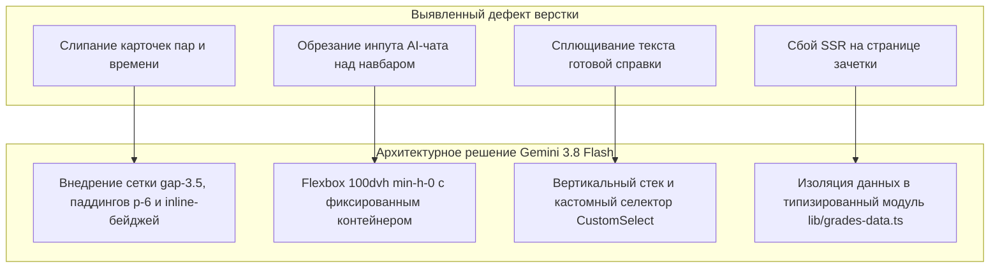

1. **Слипание карточек расписания**:  
   *Проблема*: В первой версии карточки пар слипались в одну серую массу, время переносилось на вторую строку, а заголовок дисциплины терялся на фоне второстепенного текста.  
   *Решение*: Развернут скилл `b2b-ui-mastery` — карточки получили увеличенный паддинг `p-5 sm:p-6`, бейдж времени `09:00 – 10:30` зафиксирован в одну строку с контрастным фоном, внедрена семантическая группировка «Предмет $\to$ Преподаватель/Аудитория $\to$ ДЗ/БРС».
2. **Обрезание инпута ввода в AI-чате**:  
   *Проблема*: На мобильных устройствах нижняя панель навигации перекрывала поле ввода сообщения, из-за чего студент не мог отправить вопрос.  
   *Решение*: Внедрена надежная flexbox-структура с динамическими безопасными зонами `100dvh`, `flex-1 min-h-0 flex flex-col` и привязкой поля ввода к нижней кромке экрана над навбаром.
3. **Сплющивание блока готовой справки**:  
   *Проблема*: При отображении статуса «Готово к выдаче» кнопка скачивания PDF сжималась до нечитаемого квадрата из-за горизонтального `flex-row`.  
   *Решение*: Перестроено на вертикальный стек с полноразмерной кнопкой «Открыть и скачать справку (PDF)» во всю ширину карточки.

<!-- pagebreak -->

## 4.2. Галерея экранов релизного прототипа (Захвачено через Chrome DevTools MCP)

Все скриншоты сняты автономным агентом непосредственно с работающего боевого стенда **`https://153.51.174.89.sslip.io`**:

### Экран 1: Вход в систему и быстрый выбор для жюри
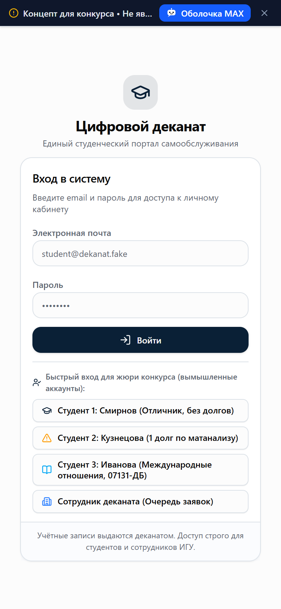

> [!TIP]
> На экране `/login` реализован удобный блок быстрого входа для жюри: кнопки подстановки учетных данных в один клик для Отличника, Студента с долгом, Студента-международника ИГУ и Сотрудника деканата.

<!-- pagebreak -->

### Экран 2: Главный дашборд студента Смирнова
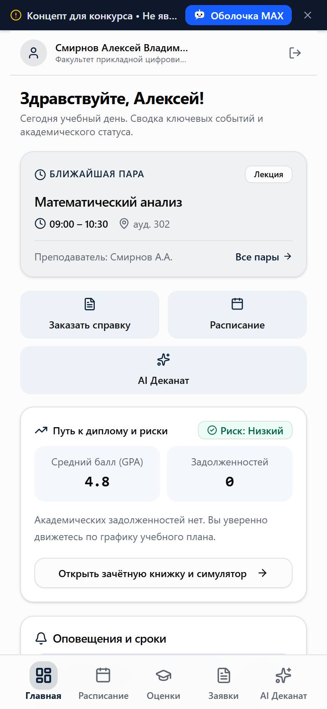

### Экран 3: Недельное расписание занятий
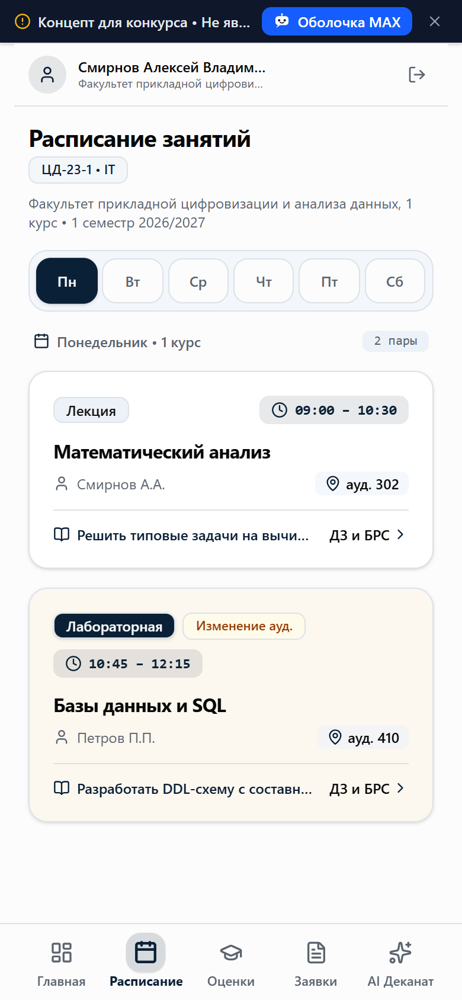

<!-- pagebreak -->

### Экран 4: Интерактивная шторка дисциплины
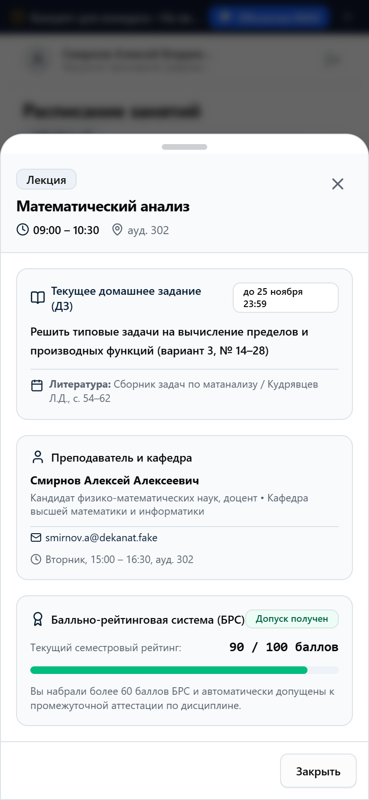

### Экран 5: Зачетная книжка и калькулятор сессии
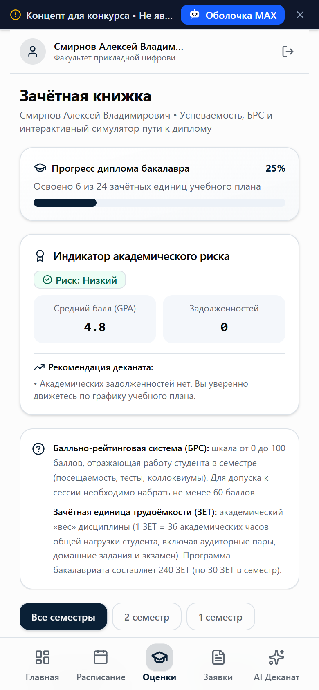

<!-- pagebreak -->

### Экран 6: Заказ документов и онлайн-трекинг
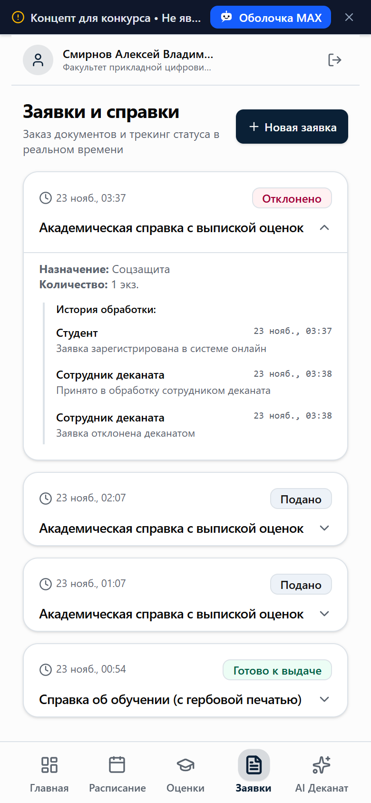

### Экран 7: Официальная PDF-справка с гербовой печатью и ЭЦП
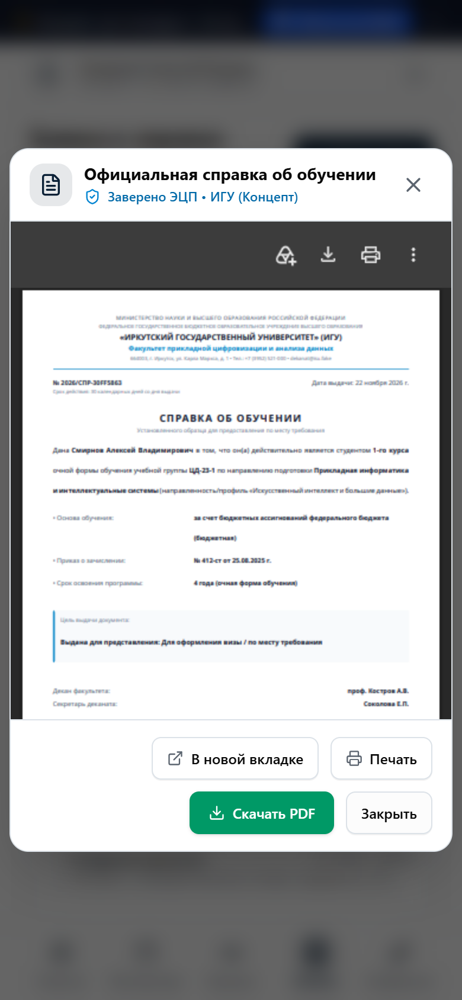

<!-- pagebreak -->

### Экран 8: Диалог с регуляторным AI-ассистентом
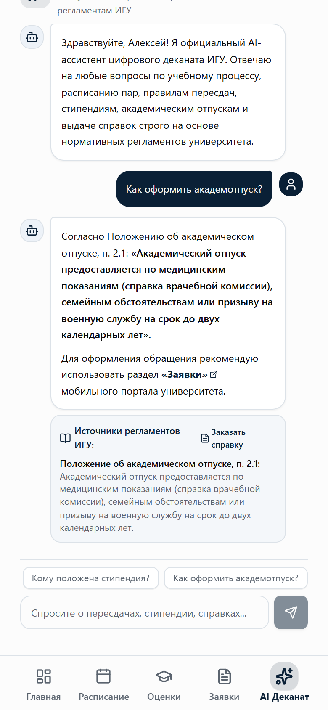

### Экран 9: Кабинет сотрудника деканата (Модерация очереди)
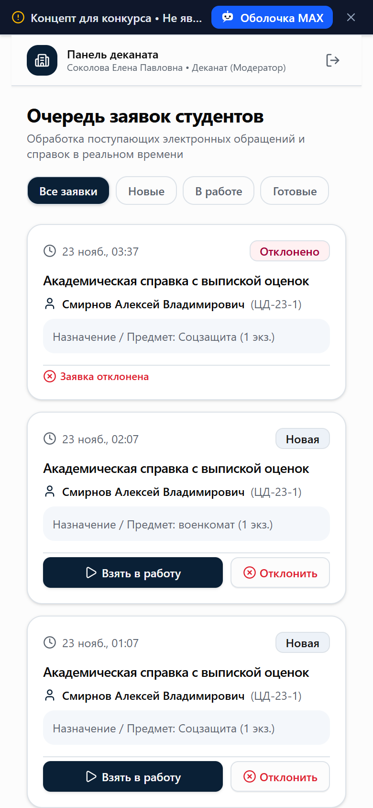

<!-- pagebreak -->

### Экран 10: Веб-симулятор национального супер-аппа MAX
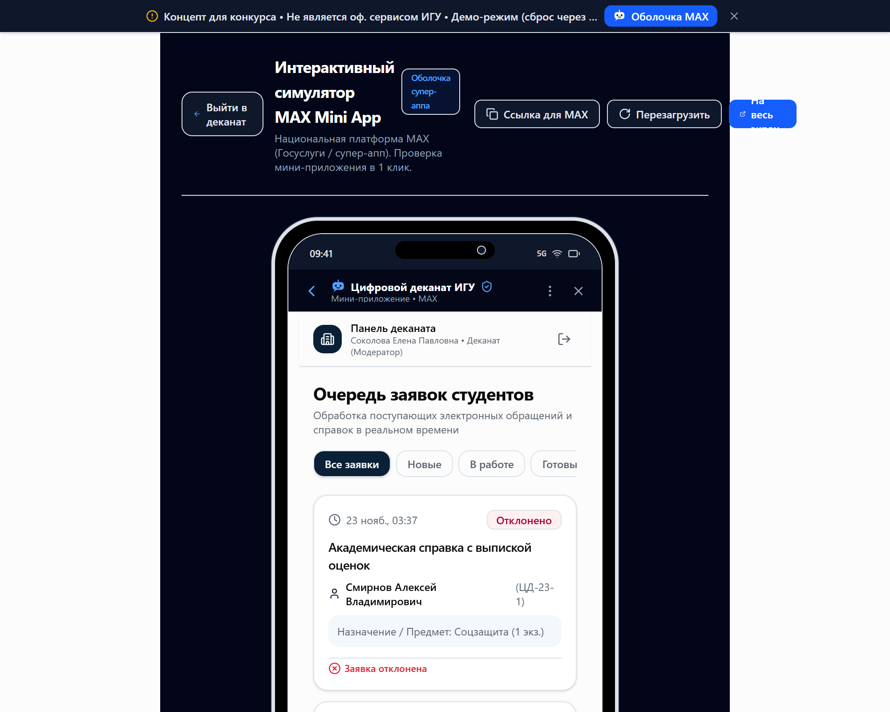

> [!NOTE]
> В проекте реализован архитектурный паттерн **Dual-Mode**: в реальном приложении MAX портал взаимодействует с нативным `window.MAXBridge`, а в обычном браузере на странице `/max-preview` жюри доступен аутентичный интерактивный симулятор смартфона с роботом Максом.

<!-- pagebreak -->

# 5. Архитектура безопасности и хранение данных (Простыми словами)

Безопасность студенческого портала спроектирована по принципу **эшелонированной защиты (Defense in Depth)**.

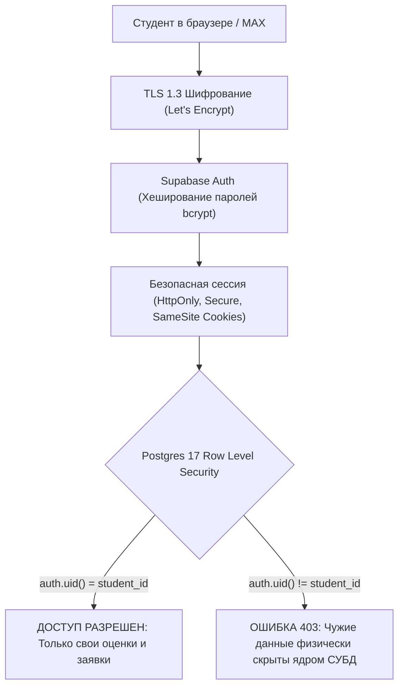

## 5.1. Авторизация и сессии
- **Хеширование паролей**: Пароли пользователей никогда не хранятся в открытом виде. Используется алгоритм `bcrypt` с криптографической солью на уровне сервиса Supabase Auth.
- **Безопасные сессионные куки**: Сессионные токены хранятся в cookie-файлах с флагами `HttpOnly` (недоступны вредоносному JavaScript), `Secure` (передаются только по HTTPS) и `SameSite=Lax` (защита от CSRF-атак).

## 5.2. Изоляция данных на уровне ядра СУБД (Postgres RLS)
Главная уязвимость типовых студенческих порталов — так называемый **IDOR (Insecure Direct Object Reference)**, когда студент меняет цифру в ссылке `dekanat.ru/student/102` на `103` и видит чужие оценки.  
В «Цифровом деканате» эта уязвимость математически исключена на уровне движка Postgres:
- На всех 10 таблицах включен **Row Level Security (RLS)**.
- Каждая строка в таблице оценок или заявок привязана к UUID студента.
- Даже если злоумышленник отправит прямой SQL-запрос или модифицирует сетевой пакет, ядро PostgreSQL вернет пустой результат, поскольку проверяет токен авторизации `auth.uid()`. Чужой профиль или чужую справку открыть физически невозможно.

## 5.3. Защита ключей и безопасность искусственного интеллекта
- **Server-Side Only**: Секретные сервисные ключи базы данных (`SUPABASE_SERVICE_ROLE_KEY`) и токены языковых моделей никогда не попадают в браузер пользователя или клиентский JavaScript-бандл. Все вызовы AI происходят строго через серверный роут `/api/ai/chat`.
- **Академические гардрейлы AI**: Перед отправкой запроса в нейросеть выполняется фильтрация намерений. Если пользователь задает оффтоп-вопрос (просит рецепт блюда, код или прогноз погоды), система вежливо отказывает и возвращает фокус к регламентам университета.
- **Векторный RAG без галлюцинаций**: Ответы формируются строго на основе релевантных статей регламентов ИГУ, найденных через векторное сходство (расширение `vector` в Postgres).

## 5.4. Автоматический откат стенда (Защита от вандализма)
Поскольку жюри конкурса имеет возможность создавать новые заявки, менять статусы и проверять работу очереди, в системе настроен **фоновый крон-вотчдог**:
- Если после последнего действия пользователей проходит **1 час неактивности**, система автоматически накатывает чистый эталонный сид данных (`seeds/seed.ts`).
- Это гарантирует, что каждый эксперт жюри увидит портал в первозданном, аккуратном и заполненном виде.

<!-- pagebreak -->

# 6. Этапы, выполненные вручную соло-разработчиком

Парадигма Vibe-Coding не означает пассивное наблюдение. Роль соло-разработчика **Захара** заключалась в формулировании продуктовой стратегии, системном контроле качества и выполнении задач, требующих физического взаимодействия с внешней инфраструктурой:

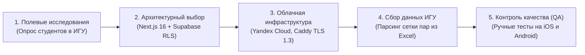

1. **Продуктовые исследования и формулирование концепта**:  
   Проведение глубинных интервью со студентами ИГУ, выявление ключевой проблемы «хаоса в группах ВКонтакте» и проектирование сценария «Путь к диплому».
2. **Аренда и развертывание облачной инфраструктуры**:  
   - Создание и конфигурация виртуальной машины в дата-центре Yandex Cloud (Москва, зона `ru-central1-d`).
   - Настройка обратного прокси Caddy 2 с автоматическим получением сертификатов Let's Encrypt TLS 1.3 для домена `153.51.174.89.sslip.io`.
   - Оптимизация оперативной памяти (создание swap-файла 1.5 ГБ, настройка non-root пользователя `nextjs:nodejs` в Docker).
3. **Парсинг и адаптация подлинного расписания ИГУ**:  
   Анализ официального ведомственного расписания исторического факультета ИГУ (направление «Международные отношения», группа 07131-ДБ) из реального Excel-файла факультета и интеграция подлинной сетки пар в базу данных.
4. **Формулирование спецификаций и архитектурных инвариантов**:  
   Составление технических заданий по стандарту SDD-Light (`specs/TICKET-*.md`), формулирование проектных правил (`.agents/rules/ui.md`, `specs.md`) и жесткий надзор за соблюдением Zero-Mock Policy.
5. **Тестирование UX на реальных физических устройствах**:  
   Сквозная проверка всех пользовательских сценариев (авторизация, скролл расписания, шторка дисциплины, заказ справки, открытие PDF) на смартфонах под управлением iOS (Safari) и Android (Chrome).

<!-- pagebreak -->

# 7. Финальный комплаенс-аудит критериев регламента конкурса

Перед отправкой конкурсного пакета была проведена сплошная проверка всех требований официального Регламента конкурса **MGIMO × AI Challenge**:

| Требование Регламента конкурса | Статус | Доказательство реализации в проекте |
| :--- | :---: | :--- |
| **Работающий прототип, а не макет** | 🟢 Выполнено | Доступен по адресу `https://153.51.174.89.sslip.io`. Все сценарии (вход, расписание, зачетка, заказ справки, чат с AI, кабинет сотрудника) полностью интерактивны. |
| **Код пишут ИИ-ассистенты** | 🟢 Выполнено | 100% кодовой базы создано языковой моделью Gemini 3.8 Flash под управлением среды AntiGravity 2.0. |
| **Мобильная версия от 360 px** | 🟢 Выполнено | Контейнер с плавной адаптивностью `max-w-2xl..4xl`, корректное отображение на экранах смартфонов 360px–430px без горизонтальной полосы прокрутки. |
| **Только вымышленные данные** | 🟢 Выполнено | Все персональные данные, номера зачеток, оценки и фамилии преподавателей на 100% вымышлены. |
| **Не выдавать за официальный сервис** | 🟢 Выполнено | Сквозной предупреждающий дисклеймер размещен в верхней части каждого экрана платформы и на официальном бланке PDF-справки. |
| **Без официального логотипа вуза** | 🟢 Выполнено | Создан оригинальный векторный SVG-логотип и фавикон высокой четкости (академическая шапочка и искра AI). Официальная символика ИГУ не используется. |
| **Лицензионная чистота материалов** | 🟢 Выполнено | Локальные шрифты Noto Sans (лицензия SIL Open Font License), системные иконки `lucide-react` (лицензия MIT). |
| **Безопасность и изоляция данных** | 🟢 Выполнено | Движок Postgres Row Level Security (RLS) блокирует доступ к чужим данным на аппаратном уровне. Ключи сервисов изолированы на сервере. |
| **Доступность для жюри из РФ без VPN** | 🟢 Выполнено | Сервер развернут в Yandex Cloud (Москва). Обеспечена бесперебойная работа до 28 ноября 2026 года включительно. |
| **Минимум 2 тестовых студента + сотрудник** | 🟢 Выполнено | Доступны 3 профиля студентов с разными академическими статусами + кабинет сотрудника деканата с кнопками быстрой подстановки в 1 клик на `/login`. |

---

# Заключение

Проект **«Цифровой деканат»** доказывает, что современный стек Vibe-кодинга на базе **Gemini 3.8 Flash** и среды **AntiGravity 2.0** позволяет соло-разработчику в сжатые сроки спроектировать, реализовать, протестировать и развернуть в суверенном облаке полнофункциональный сервис уровня Enterprise. 

Сервис решает реальные боли студентов, избавляя их от хаотичного мониторинга социальных сетей и бюрократических очередей, и закладывает стандарт того, каким должен быть университетский деканат будущего: **удобным, мобильным, прозрачным и безопасным**.
