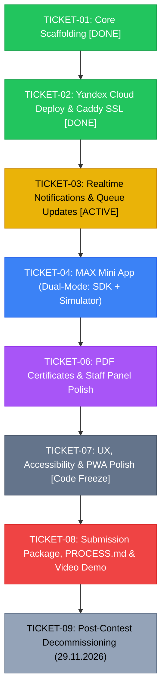

# 📌 Состояние проекта (STATE.md)

**Проект**: Цифровой деканат (Digital Deanery Concept — MGIMO × AI Challenge, трек Vibe-Coding)  
- 🚀 **Оперативный статус платформы**: **ЭТАП 3: Realtime-уведомления и живое обновление очереди деканата**. Прототип успешно развернут в **Yandex Cloud (Москва)** на публичном адресе с авто-SSL Let's Encrypt: **`https://153.51.174.89.sslip.io`**. База данных Supabase Cloud реактивирована (`ACTIVE_HEALTHY`), настроен Keep-Alive crontab. Сервис работает без VPN из РФ.
- 🎯 **Активный фокус**: **Реализация TICKET-03 (Realtime-уведомления и обновление очереди модерации)** — подключение публикаций Supabase Realtime (`notifications`, `requests`, `request_events`), показ живых тостов Sonner при смене статуса заявки и мгновенное обновление дашборда деканата.
- 🕒 **Инвариант часовых поясов**: Разработчик Захар в Иркутске (IRKT, UTC+8). Сервер деплоя и дедлайн конкурса в Москве (MSK, UTC+3). Дельта: $+5$ часов ($\text{IRKT} = \text{MSK} + 5$). Дедлайн сдачи: **22.11.2026 23:59 MSK** (= 23.11.2026 04:59 IRKT). Окно активности прототипа для жюри: до 28.11.2026 включительно.
- **Дата обновления**: 2026-11-22 (02:25 IRKT / 21:25 21.11 МСК)

---

## 1. 📊 Текущий статус слоёв платформы

| Слой платформы | Статус | Комментарий / Метрики |
| :--- | :--- | :--- |
| **Frontend & UI Layer** (`app/`, `components/`) | ✅ Mobile-First SSoT | Мобильная адаптивность $\ge 360\text{ px}$ без горизонтального скролла, Tailwind CSS v4, палитра OKLCH, shadcn/ui. 7 маршрутов (`/login`, `/dashboard`, `/schedule`, `/grades`, `/requests`, `/ai`, `/staff`). Сквозной баннер-дисклеймер конкурса на всех экранах. |
| **Production Cloud & Hosting** (`153.51.174.89`) | 🟢 **100% LIVE (HTTPS)** | **`https://153.51.174.89.sslip.io`**. ВМ Yandex Cloud (2 vCPU, 2 ГБ RAM, 1,5 ГБ swap), Caddy auto-SSL (Let's Encrypt), multi-stage Docker standalone (RSS ~220 МБ). Полная доступность из РФ без VPN. |
| **API & AI Assistant Layer** (`app/api/ai/chat/`) | ✅ Hybrid RAG & SOCKS5 Proxy | Серверный роут с семантическим поиском по 40 фрагментам регламентов (`pgvector`), SOCKS5-эгресс к OpenRouter (`google/gemma-4-31b-it:free`), резервным `baidu/ernie-5.5` и детерминированным оффлайн-фоллбэком с обязательным цитированием статей. |
| **Academic Analytics Layer** (`lib/academic.ts`) | ✅ SSoT Verified v1.0 | Чистые функции расчета прогресса диплома, суммирования зачетных единиц (ЗЕТ), среднего балла (GPA) и выявления факторов академического риска (`LOW`, `MEDIUM`, `CRITICAL`). **6/6 тестов Vitest PASSED (0.66с)**. |
| **Database & Security Layer** (`supabase/migrations/`) | ✅ Postgres 17 & RLS DDL | Миграция `0001_init.sql`: 10 таблиц, расширение `vector`, функция `match_regulation_chunks`. Строгий Row Level Security: студент изолирован на уровне `auth.uid()`, сотрудник деканата авторизован на модерацию. Статус кластера: `ACTIVE_HEALTHY`. |
| **Seed & Synthetic Data Layer** (`seeds/seed.ts`) | ✅ 100% Fictional Data | Полностью синтетический контур (требование комплаенса): 3 тестовых профиля в Supabase Auth (`student1`, `student2`, `staff`), учебное расписание, зачетка с БРС и 40 статей вымышленных регламентов. Авторизация проверена (SUCCESS). |
| **Validation & Quality Gates** | 🛡️ Quality Gates PASSED | `pnpm typecheck` (0 ошибок), `pnpm lint` (0 предупреждений), `pnpm test` (6/6 тестов успешно), `pnpm build` (успешная standalone-сборка за 5.1 с). |

---

## 2. 📜 Решённые задачи и инциденты (Ротация в CHANGELOG.md)

1. ⚡ **`TICKET-SPEC-SYSTEM: Внедрение тикет-ориентированной системы спецификаций` (11.11.2026)**:
   - Внедрена строгая система спецификаций в каталоге `specs/`: главный реестр `specs/README.md`, 8 детальных спецификаций тикетов (TICKET-01..08).
   - Формализованы правила рабочего процесса в `.agents/rules/specs.md`.
2. ⚡ **`TICKET-01: Базовый каркас, схемы и проверка работоспособности` (11.11.2026)**:
   - Развернут технологический стек: Next.js 16, Tailwind CSS v4, shadcn/ui, OKLCH, мобильная адаптивность $\ge 360\text{px}$.
   - Спроектирована схема: 10 таблиц, `pgvector`, RLS. Скрипт `seeds/seed.ts` с 3 вымышленными аккаунтами. Модуль аналитики `lib/academic.ts` (6 тестов PASSED).
   - Спецификация перенесена в архив: [`specs/archive/TICKET-01-core-scaffolding.md`](../specs/archive/TICKET-01-core-scaffolding.md).
3. ⚡ **`TICKET-02: Облачная инфраструктура и суверенный деплой на Yandex Cloud` (22.11.2026)**:
   - Выполнен сквозной EGM+ Review и исследование хостингов в РФ (выявлено закрытие Free Tier REG.облака).
   - Развернута ВМ Yandex Cloud (Москва, 2 vCPU, 2 ГБ RAM, 1,5 ГБ swap), запущен Caddy 2 с автоматическим Let's Encrypt TLS.
   - Восстановлен заснувший кластер Supabase Cloud через `restore_project` (`ACTIVE_HEALTHY`).
   - Настроен системный Keep-Alive crontab (каждые 12 часов). Публичный защищенный адрес: **`https://153.51.174.89.sslip.io`**.
   - Спецификация перенесена в архив: [`specs/archive/TICKET-02-cloud-and-deployment.md`](../specs/archive/TICKET-02-cloud-and-deployment.md).

---

## 3. 🎯 Активный тикет: TICKET-03 — Realtime-уведомления и обновление очереди

- **Идентификатор**: `TICKET-03`
- **Название**: Realtime-уведомления и обновление очереди (Realtime Push & Queue Updates)
- **Статус**: 🟡 **ACTIVE** (В работе)
- **Плановый дедлайн**: 22.11.2026
- **Приоритет**: P1 (Высокий)
- **Спецификация**: [`specs/TICKET-03-realtime-notifications.md`](../specs/TICKET-03-realtime-notifications.md)

### Чек-лист реализации (Scope)
- [ ] 1. **Публикация Realtime в Postgres**: Добавление таблиц `notifications`, `requests`, `request_events` в публикацию `supabase_realtime` через SQL миграцию.
- [ ] 2. **Клиентские подписки студента (`postgres_changes`)**: Подписка на изменение статусов своих заявок и новые уведомления с фильтрацией по `auth.uid()`.
- [ ] 3. **Всплывающие уведомления (Sonner)**: Мгновенный показ тостов при получении оповещения или смене статуса заявки без перезагрузки страниц.
- [ ] 4. **Живое обновление очереди деканата (`/staff`)**: Автоматическое добавление новой заявки в верх списка обращений при создании ее студентом.
- [ ] 5. **Менеджмент сокетов и утечек**: Корректная отписка от каналов при размонтировании компонентов (`removeChannel`).

---

## 4. 🏛️ Дорожная карта и граф зависимостей тикетов (Mermaid)

### 📋 Реестр спецификаций платформы

| ID | Название | Статус | Приоритет | Спецификация |
| :--- | :--- | :--- | :--- | :--- |
| **TICKET-01** | Базовый каркас, схемы и проверка работоспособности | 🟢 **DONE** | P0 (Критичный) | [TICKET-01](archive/TICKET-01-core-scaffolding.md) |
| **TICKET-02** | Облачная инфраструктура и деплой на Yandex Cloud | 🟢 **DONE** | P0 (Критичный) | [TICKET-02](archive/TICKET-02-cloud-and-deployment.md) |
| **TICKET-03** | Realtime-уведомления и обновление очереди | 🟡 **ACTIVE** | P1 (Высокий) | [TICKET-03](TICKET-03-realtime-notifications.md) |
| **TICKET-04** | Оболочка MAX Mini App (Госуслуги / MAX) Dual-Mode | ⚪ **OPEN** | P1 (Высокий) | [TICKET-04](TICKET-04-max-mini-app.md) |
| **TICKET-05** | Оболочка Telegram Mini App | ⚪ **SKIPPED** | P2 (Отложен) | [TICKET-05](TICKET-05-telegram-mini-app.md) |
| **TICKET-06** | Генератор PDF-справок и панель деканата | ⚪ **OPEN** | P1 (Высокий) | [TICKET-06](TICKET-06-certificates-and-staff-polish.md) |
| **TICKET-07** | Финальная полировка UX, доступность и PWA | ⚪ **OPEN** | P1 (Высокий) | [TICKET-07](TICKET-07-ux-pwa-final-polish.md) |
| **TICKET-08** | Конкурсный пакет, отчет PROCESS.md и видео | ⚪ **OPEN** | P0 (Критичный) | [TICKET-08](TICKET-08-submission-package.md) |
| **TICKET-09** | Вывод инфраструктуры из эксплуатации и защита от списаний | ⚪ **OPEN (Scheduled: 29.11.2026)** | P1 (Безопасность) | [TICKET-09](../specs/TICKET-09-post-contest-decommissioning.md) |
