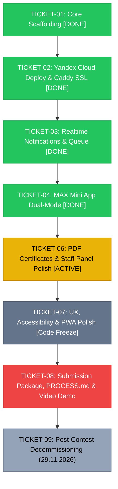

# 📌 Состояние проекта (STATE.md)

**Проект**: Цифровой деканат (Digital Deanery Concept — MGIMO × AI Challenge, трек Vibe-Coding)  
- 🚀 **Оперативный статус платформы**: **ЭТАП 4: Генератор PDF-справок и полировка панели деканата**. Прототип развернут в **Yandex Cloud (Москва)** с авто-SSL Let's Encrypt: **`https://153.51.174.89.sslip.io`**. База данных Supabase Cloud реактивирована, публикации сокетов `supabase_realtime` включены (`notifications`, `requests`, `request_events`), работает Dual-Mode симулятор платформы MAX (`/max-preview`).
- 🎯 **Активный фокус**: **Реализация TICKET-06 (Генератор официальных PDF-справок с гербовой печатью и полировка панели деканата)** — генерация PDF на клиенте/сервере (`@react-pdf/renderer`), защищенное хранилище и модальное окно предпросмотра.
- 🕒 **Инвариант часовых поясов**: Разработчик Захар в Иркутске (IRKT, UTC+8). Сервер деплоя и дедлайн конкурса в Москве (MSK, UTC+3). Дельта: $+5$ часов ($\text{IRKT} = \text{MSK} + 5$). Дедлайн сдачи: **22.11.2026 23:59 MSK** (= 23.11.2026 04:59 IRKT). Окно активности прототипа для жюри: до 28.11.2026 включительно.
- **Дата обновления**: 2026-11-22 (03:42 IRKT / 22:42 21.11 МСК)

---

## 1. 📊 Текущий статус слоёв платформы

| Слой платформы | Статус | Комментарий / Метрики |
| :--- | :--- | :--- |
| **Frontend & UI Layer** (`app/`, `components/`) | ✅ Mobile-First SSoT + MAX Dual-Mode | Мобильная адаптивность $\ge 360\text{ px}$, Tailwind CSS v4, палитра OKLCH, тосты Sonner. Маршруты: `/login`, `/dashboard`, `/schedule`, `/grades`, `/requests`, `/ai`, `/staff`, `/max-preview`. Сквозной дисклеймер с кнопкой «Оболочка MAX». |
| **MAX Mini App Layer** (`lib/max-bridge.ts`, `/max-preview`) | 🟢 **100% Dual-Mode LIVE** | Клиентский адаптер `MAXBridge SDK` (`ready`, `expand`, `onBackButtonPressed`), веб-симулятор смартфона для жюри на `/max-preview`, манифест `docs/max-bot-manifest.json` для `dev.max.ru`. |
| **Realtime Push & Queue Layer** (`app/(student)/requests`, `app/(staff)/staff`) | 🟢 **100% Realtime Active** | Публикация `supabase_realtime` (`requests`, `request_events`, `notifications`), живой таймлайн заявок, тосты Sonner при смене статусов, моментальное автодобавление новых заявок в очередь деканата с мягкой пульсирующей подсветкой. |
| **Production Cloud & Hosting** (`153.51.174.89`) | 🟢 **100% LIVE (HTTPS)** | **`https://153.51.174.89.sslip.io`**. ВМ Yandex Cloud (2 vCPU, 2 ГБ RAM, 1,5 ГБ swap), Caddy auto-SSL (Let's Encrypt), multi-stage Docker standalone (RSS ~220 МБ). Полная доступность из РФ без VPN. |
| **API & AI Assistant Layer** (`app/api/ai/chat/`) | ✅ Hybrid RAG & SOCKS5 Proxy | Серверный роут с семантическим поиском по 40 фрагментам регламентов (`pgvector`), SOCKS5-эгресс к OpenRouter (`google/gemma-4-31b-it:free`), резервным `baidu/ernie-5.5` и детерминированным оффлайн-фоллбэком с обязательным цитированием статей. |
| **Academic Analytics Layer** (`lib/academic.ts`) | ✅ SSoT Verified v1.0 | Чистые функции расчета прогресса диплома, суммирования зачетных единиц (ЗЕТ), среднего балла (GPA) и выявления факторов академического риска (`LOW`, `MEDIUM`, `CRITICAL`). **6/6 тестов Vitest PASSED**. |
| **Database & Security Layer** (`supabase/migrations/`) | ✅ Postgres 17 & RLS DDL | 10 таблиц, расширение `vector`, строгий RLS: студент изолирован на уровне `auth.uid()`, сотрудник деканата авторизован на модерацию очереди. Статус кластера: `ACTIVE_HEALTHY`. |
| **Seed & Synthetic Data Layer** (`seeds/seed.ts`) | ✅ 100% Fictional Data | Полностью синтетический контур (требование комплаенса): 3 тестовых профиля в Supabase Auth (`student1`, `student2`, `staff`), учебное расписание, зачетка с БРС и 40 статей вымышленных регламентов. |
| **Validation & Quality Gates** | 🛡️ Quality Gates PASSED | `pnpm typecheck` (0 ошибок), `pnpm lint` (0 предупреждений), `pnpm test` (6/6 тестов успешно), `pnpm build` (успешная standalone-сборка 14 страниц). |

---

## 2. 📜 Решённые задачи (Ротация в CHANGELOG.md — последние 3)

1. ⚡ **`TICKET-02: Облачная инфраструктура и суверенный деплой на Yandex Cloud` (22.11.2026)**:
   - Развернута ВМ Yandex Cloud (Москва, 2 vCPU, 2 ГБ RAM, 1,5 ГБ swap), запущен Caddy 2 с автоматическим Let's Encrypt TLS: `https://153.51.174.89.sslip.io`. Реактивирован кластер Supabase Cloud (`ACTIVE_HEALTHY`), настроен системный Keep-Alive crontab.
2. ⚡ **`TICKET-03: Realtime-уведомления и живое обновление очереди` (22.11.2026)**:
   - Включена публикация `supabase_realtime` для `notifications`, `requests`, `request_events` с `REPLICA IDENTITY FULL`.
   - Интегрирована `sonner` v2.0.8, настроены клиентские сокет-подписки студента и сотрудника деканата: живое обновление таймлайна, тосты Sonner, пульсирующая подсветка новых заявок.
3. ⚡ **`TICKET-04: Оболочка MAX Mini App (Госуслуги / MAX) Dual-Mode` (22.11.2026)**:
   - Создан типизированный мост `lib/max-bridge.ts` (`ready`, `expand`, `onBackButtonPressed`, safe-area insets).
   - Развернут интерактивный симулятор `/max-preview` с 3D-фреймом смартфона, системным статус-баром, шапкой MAX с верификацией и панелью жюри. Подготовлен манифест `docs/max-bot-manifest.json` для `dev.max.ru`.

---

## 3. 🎯 Активный тикет: TICKET-06 — Генератор PDF-справок и панель деканата

- **Идентификатор**: `TICKET-06`
- **Название**: Генератор официальных PDF-справок и полировка панели деканата (PDF Generator & Staff Console Polish)
- **Статус**: 🟡 **ACTIVE** (В работе)
- **Плановый дедлайн**: 22.11.2026
- **Приоритет**: P1 (Высокий)
- **Спецификация**: [`specs/TICKET-06-certificates-and-staff-polish.md`](../specs/TICKET-06-certificates-and-staff-polish.md)

### Чек-лист реализации (Scope)
- [ ] 1. **Движок генерации PDF-справок**: Шаблонизатор справки об обучении с реквизитами ИГУ, гербовой печатью концепта и факсимиле декана.
- [ ] 2. **Модальное окно предпросмотра**: Просмотр сформированной справки в веб-интерфейсе перед скачиванием.
- [ ] 3. **Скачивание и хранение**: Экспорт файла `spravka_ob_obuchenii.pdf` в один клик.
- [ ] 4. **Интеграция с очередью деканата**: Кнопка «Сгенерировать справку» прямо из карточки заявки на `/staff`.

---

## 4. 🏛️ Дорожная карта и граф зависимостей тикетов (Mermaid)

### 📋 Реестр спецификаций платформы

| ID | Название | Статус | Приоритет | Спецификация |
| :--- | :--- | :--- | :--- | :--- |
| **TICKET-01** | Базовый каркас, схемы и проверка работоспособности | 🟢 **DONE** | P0 (Критичный) | [TICKET-01](archive/TICKET-01-core-scaffolding.md) |
| **TICKET-02** | Облачная инфраструктура и деплой на Yandex Cloud | 🟢 **DONE** | P0 (Критичный) | [TICKET-02](archive/TICKET-02-cloud-and-deployment.md) |
| **TICKET-03** | Realtime-уведомления и обновление очереди | 🟢 **DONE** | P1 (Высокий) | [TICKET-03](archive/TICKET-03-realtime-notifications.md) |
| **TICKET-04** | Оболочка MAX Mini App (Госуслуги / MAX) Dual-Mode | 🟢 **DONE** | P1 (Высокий) | [TICKET-04](archive/TICKET-04-max-mini-app.md) |
| **TICKET-05** | Оболочка Telegram Mini App | ⚪ **SKIPPED** | P2 (Отложен) | [TICKET-05](TICKET-05-telegram-mini-app.md) |
| **TICKET-06** | Генератор PDF-справок и панель деканата | 🟡 **ACTIVE** | P1 (Высокий) | [TICKET-06](TICKET-06-certificates-and-staff-polish.md) |
| **TICKET-07** | Финальная полировка UX, доступность и PWA | ⚪ **OPEN** | P1 (Высокий) | [TICKET-07](TICKET-07-ux-pwa-final-polish.md) |
| **TICKET-08** | Конкурсный пакет, отчет PROCESS.md и видео | ⚪ **OPEN** | P0 (Критичный) | [TICKET-08](TICKET-08-submission-package.md) |
| **TICKET-09** | Вывод инфраструктуры из эксплуатации и защита от списаний | ⚪ **OPEN (Scheduled: 29.11.2026)** | P1 (Безопасность) | [TICKET-09](../specs/TICKET-09-post-contest-decommissioning.md) |
