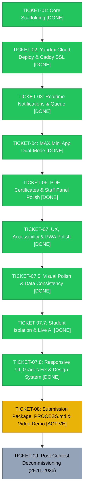

# 📌 Состояние проекта (STATE.md)

**Проект**: Цифровой деканат (Digital Deanery Concept — MGIMO × AI Challenge, трек Vibe-Coding)  
- 🚀 **Оперативный статус платформы**: **Глобальные стандарты дизайна Impeccable (v4.10.0) и Better-Interface развернуты глобально (~/.gemini/config/skills/). Обязательный протокол использования UI-скиллов закреплен в глобальных инвариантах AGENTS.md и правилах ui.md. Десктопная адаптивность (DesktopNav, 2-колоночные сетки, фиксированный AI-чат) полностью верифицирована (31/31 Vitest)**. Прототип развернут в **Yandex Cloud (Москва)** с авто-SSL Let's Encrypt: **`https://153.51.174.89.sslip.io`**.
- 🎯 **Активный фокус**: **TICKET-08 [ACTIVE] (Сборка конкурсного пакета, отчет PROCESS.md, видео-демо и финальные регламенты)**.
- 🕒 **Инвариант часовых поясов**: Разработчик Захар в Иркутске (IRKT, UTC+8). Сервер деплоя и дедлайн конкурса в Москве (MSK, UTC+3). Дельта: $+5$ часов ($\text{IRKT} = \text{MSK} + 5$). Дедлайн сдачи: **22.11.2026 23:59 MSK** (= 23.11.2026 04:59 IRKT). Окно активности прототипа для жюри: до 28.11.2026 включительно.
- **Дата обновления**: 2026-11-23 (02:57 IRKT / 21:57 22.11 МСК)

---

## 1. 📊 Текущий статус слоёв платформы

| Слой платформы | Статус | Комментарий / Метрики |
| :--- | :--- | :--- |
| **Frontend & UI Layer** (`app/`, `components/`) | 🟢 **100% Fluid & WCAG AA** | Плавный адаптивный контейнер `max-w-2xl..4xl`, Tailwind CSS v4, палитра OKLCH, тосты Sonner. Single-Scrollbar на десктопе, дисклеймер с автовыравниванием, контрастные бейджи WCAG AA ($\ge 4.5:1$), 100% Zero-Emoji, Zero Native Selects (`CustomSelect`). |
| **Timetable & Subject Drawer** (`lib/schedule-data.ts`, `components/subject-sheet.tsx`) | 🟢 **100% Authentic ISU Live** | Сетка пар 1 курса направления «Международные отношения» ИГУ (группа 07131-ДБ) из проверенного Excel-файла + группа ИТ (`ЦД-23-1`). SSoT привязка пар на главной к группе студента. Интерактивная шторка дисциплины (ДЗ, дедлайны, литература, БРС). |
| **PWA & Mobile Layer** (`app/manifest.ts`, `public/icon-*.png`) | 🟢 **100% PWA Native Live** | Автономный Web App Manifest Next.js App Router (`/manifest.webmanifest`), палитра `#0f172a`, standalone-режим, PWA-иконки 192x192, 512x512 и `apple-touch-icon.png`. |
| **MAX Mini App Layer** (`lib/max-bridge.ts`, `/max-preview`) | 🟢 **100% Dual-Mode LIVE** | Клиентский адаптер `MAXBridge SDK`, чистый симулятор смартфона для жюри на `/max-preview` (без двойного дисклеймера, с кнопкой «Выйти в деканат», аутентичным логотипом Робота Макса и полным отсутствием технического жаргона). |
| **Academic Analytics Layer** (`lib/grades-data.ts`, `app/(student)/grades`) | 🟢 **100% Synchronized (GPA 4.8)** | Полная ликвидация сбоя SSR на `/grades` через вынос в `lib/grades-data.ts`. Синхронизирован единый средний балл GPA **4.8** на главной и в зачетке, семантические тултипы БРС, прикладные рекомендации деканата и строгая визуальная симметрия карточек дисциплин с ЗЕТ. |
| **API & AI Assistant Layer** (`app/api/ai/chat/`, `app/(student)/ai`) | 🟢 **100% Guardrails & Markdown** | Двухуровневый академический guardrail (вежливый отказ на оффтоп), flexbox-верстка со стабильным инпутом над нижним баром (`100dvh`, `min-h-0`), живая нейросеть через SOCKS5 (`nvidia/nemotron-3.5-lightning:free`), рендеринг Markdown без звездочек `**`. |
| **Realtime Push & Queue Layer** (`app/(student)/requests`, `app/(staff)/staff`) | 🟢 **100% Realtime Active** | Публикация `supabase_realtime` (`requests`, `request_events`, `notifications`), живой таймлайн заявок, анти-сдавливание готовой справки, тосты Sonner, моментальное автодобавление новых заявок в очередь деканата. |
| **Production Cloud & Hosting** (`153.51.174.89`) | 🟢 **100% LIVE (HTTPS)** | **`https://153.51.174.89.sslip.io`**. ВМ Yandex Cloud (2 vCPU, 2 ГБ RAM, 1,5 ГБ swap), Caddy auto-SSL (Let's Encrypt), multi-stage Docker standalone (RSS ~220 МБ). Полная доступность из РФ без VPN. |
| **Database & Security Layer** (`supabase/migrations/`) | ✅ Postgres 17 & RLS DDL | 10 таблиц, расширение `vector`, строгий RLS: студент изолирован на уровне `auth.uid()`, сотрудник деканата авторизован на модерацию очереди. Статус кластера: `ACTIVE_HEALTHY`. |
| **PDF & Certificate Layer** (`lib/pdf/`, `app/api/requests/[id]/certificate`) | 🟢 **100% PDF & IDOR Guard LIVE** | Генератор официальных справок об обучении A4 на `@react-pdf/renderer` v4.9.0 с локальными шрифтами Noto Sans (`public/fonts/`), синей гербовой печатью, штампом ЭЦП и вымышленными реквизитами. Защита от IDOR (401/403/200), модальное окно предпросмотра с печатью и скачиванием. 16/16 тестов в `tests/certificate.test.ts`. |
| **Validation & Quality Gates** | 🛡️ Quality Gates PASSED | `pnpm typecheck` (0 ошибок), `pnpm lint` (0 предупреждений), `pnpm test` (31/31 тестов успешно), `pnpm build` (успешная standalone-сборка 17 страниц). |

---

## 2. 📜 Решённые задачи (Ротация в CHANGELOG.md — последние 3)

1. ⚡ **`TICKET-07: Финальная полировка UI/UX, расписание ИГУ, шторка ДЗ, PWA и AI-гардрейлы` (22.11.2026)**:
   - Ликвидированы паразитные вертикальные скроллбары на экранах 1366×768 и 1920×1080 (Single-Scrollbar Policy).
   - Интегрирована сетка пар 1 курса Международных отношений ИГУ (07131-ДБ) из Excel с интерактивной шторкой дисциплин (ДЗ, дедлайны, преподаватели, БРС).
   - Внедрен PWA-манифест, единый GPA 4.8, WCAG AA бейджи и Zero-Emoji.
2. ⚡ **`TICKET-07.7: Изоляция студентов, SSoT зачетки и расписания, живой AI и автосброс демо` (23.11.2026)**:
   - Устранено залипание верхней плашки профиля и дисклеймера в оболочке MAX и мобильном браузере при скролле.
   - Разделены профили студентов: Смирнов (ЦД, GPA 4.8, 0 долгов), Кузнецова (ЦД, GPA 3.25, 1 долг по Матанализу), Иванова (МО, группа 07131-ДБ, GPA 4.67).
   - Расписание изолировано строго под группу авторизованного студента без лишних вкладок чужих факультетов.
   - Подключен живой AI-ассистент деканата через SOCKS5-прокси (`nvidia/nemotron-3.5-lightning:free`, `isFallback: false`).
   - Настроен автосброс демо-данных через 1 час неактивности по активности пользователей и крон-вотчдогу. 30/30 тестов Vitest пройдены.
3. ⚡ **`TICKET-07.8: Комплексная адаптивность UI, фикс /grades, SSoT расписания и дизайн-система` (23.11.2026)**:
   - Ликвидирован сбой SSR на `/grades` (Error 1235902522) через вынос данных в чистый TS модуль `lib/grades-data.ts`.
   - Настроена SSoT выборка ближайшей пары на главной строго по `session.groupId` (пары матанализа/БД для Смирнова вместо чужих пар МО).
   - Внедрен Fluid Container `max-w-2xl..4xl` для адаптации под планшеты, ноутбуки и десктопы.
   - Устранено сплющивание текста в карточке готовой справки на `/requests`, внедрен кастомный компонент `CustomSelect` (Zero Native Selects).
   - Исправлена flexbox-верстка AI-деканата (`100dvh`, `min-h-0`), исключающая обрезание поля ввода.
   - Удалена регистрация (`/signup`), добавлен редирект на `/login`, обновлен лейбл «Студент 1: Смирнов (Отличник, без долгов)».
   - Закреплены стандарты B2B UI в `.agents/rules/ui.md` и создан мастер-скилл `b2b-ui-mastery`. 31/31 тестов пройдены.

---

## 3. 🎯 Завершенный тикет: TICKET-07.8 — Комплексная адаптивность UI, фикс /grades и дизайн-система

- **Идентификатор**: `TICKET-07.8`
- **Название**: Комплексная адаптивность UI (Mobile-to-Desktop), фикс зачетки /grades, SSoT расписания на главной и гармонизация дизайн-стандартов
- **Статус**: 🟢 **DONE (Реализован, протестирован: 31/31 тестов, развернут на сервере Yandex Cloud)**
- **Плановый дедлайн**: 23.11.2026 03:00 IRKT / 22.11.2026 22:00 MSK
- **Приоритет**: P0 (Критичный UX и стабильность платформы)
- **Спецификация**: [`specs/TICKET-07.8-responsive-ui-grades-fix-design-system.md`](../specs/TICKET-07.8-responsive-ui-grades-fix-design-system.md)

### Чек-лист реализации (Scope)
- [x] 1. **Изоляция данных зачетки (`lib/grades-data.ts`)**: вынос `INITIAL_GRADES` и студенческих данных из клиентского `"use client"` файла в чистый TS модуль; ликвидация ошибки SSR 500 на `/grades`.
- [x] 2. **SSoT выборки ближайшей пары на главной (`/dashboard`)**: фильтрация `lessons` строго по `session.groupId` активного студента; показ пар матанализа/БД для Смирнова вместо чужих пар МО.
- [x] 3. **Fluid Responsive Layout (`app/layout.tsx` и `components/mobile-nav.tsx`)**: расширение контейнера `max-w-2xl lg:max-w-3xl xl:max-w-4xl` с сохранением мобильного удобства и адаптацией под десктоп/ноутбуки.
- [x] 4. **Анти-сдавливание справки и кастомный селектор (`/requests`)**: вертикальный стек с кнопкой «Открыть справку (PDF)» на всю ширину под текстом; кастомный селектор типа справки вместо нативного `<select>`.
- [x] 5. **Flexbox-верстка AI-деканата (`/ai`)**: фиксация инпута над нижней панелью навигации без обрезания (`flex-1 min-h-0 flex flex-col`).
- [x] 6. **Ликвидация регистрации и доработка экрана входа (`/login`)**: удаление футера `/signup`, редирект с `/signup` на `/login`, лейбл «Студент 1: Смирнов (Отличник, без долгов)».
- [x] 7. **Гармонизация дизайн-стандартов**: проектное правило `.agents/rules/ui.md` (Zero Native Selects, Anti-Flex-Squishing, Fluid Container) и глобальный скилл `b2b-ui-mastery`.

---

## 4. 🏛️ Дорожная карта и граф зависимостей тикетов (Mermaid)

### 📋 Реестр спецификаций платформы

| ID | Название | Статус | Приоритет | Спецификация |
| :--- | :--- | :--- | :--- | :--- |
| **TICKET-01** | Базовый каркас, схемы и проверка работоспособности | 🟢 **DONE** | P0 (Критичный) | [TICKET-01](archive/TICKET-01-core-scaffolding.md) |
| **TICKET-02** | Облачная инфраструктура и деплой на Yandex Cloud | 🟢 **DONE** | P0 (Критичный) | [TICKET-02](archive/TICKET-02-cloud-and-deployment.md) |
| **TICKET-03** | Realtime-уведомления и обновление очереди | 🟢 **DONE** | P1 (Высокий) | [TICKET-03](archive/TICKET-03-realtime-notifications.md) |
| **TICKET-04** | Оболочка MAX Mini App (Госуслуги / MAX) Dual-Mode | 🟢 **DONE** | P1 (Высокий) | [TICKET-04](archive/TICKET-04-max-mini-app.md) |
| **TICKET-06** | Генератор официальных PDF-справок и панель деканата | 🟢 **DONE** | P0 (Критичный) | [TICKET-06](archive/TICKET-06-certificates-and-staff-polish.md) |
| **TICKET-07** | Финальная полировка UX, расписание ИГУ и PWA | 🟢 **DONE** | P0 (Критичный) | [TICKET-07](archive/TICKET-07-ux-pwa-final-polish.md) |
| **TICKET-07.5** | Визуальная полировка UI, консистентность данных и MAX | 🟢 **DONE** | P0 (Критичный) | [TICKET-07.5](specs/TICKET-07.5-visual-polish-data-consistency.md) |
| **TICKET-07.8** | Комплексная адаптивность UI, фикс /grades и дизайн-система | 🟢 **DONE** | P0 (Критичный) | [TICKET-07.8](specs/TICKET-07.8-responsive-ui-grades-fix-design-system.md) |
| **TICKET-08** | Сборка конкурсного пакета, отчет PROCESS.md и видео-демо | 🟡 **ACTIVE** | P0 (Критичный) | [TICKET-08](specs/TICKET-08-submission-package.md) |
| **TICKET-09** | Вывод инфраструктуры из эксплуатации и защита от списаний | ⚪ **OPEN (Scheduled: 29.11.2026)** | P1 (Безопасность) | [TICKET-09](specs/TICKET-09-post-contest-decommissioning.md) |
