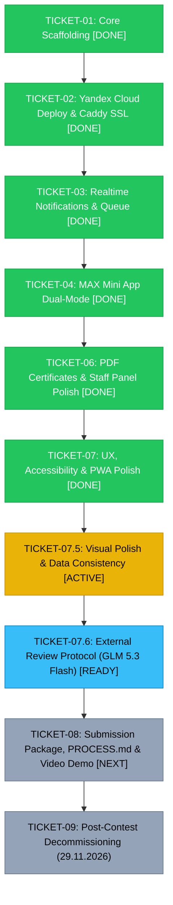

# 📌 Состояние проекта (STATE.md)

**Проект**: Цифровой деканат (Digital Deanery Concept — MGIMO × AI Challenge, трек Vibe-Coding)  
- 🚀 **Оперативный статус платформы**: **ЭТАП 6: TICKET-07 (полный UI/UX-полишинг, подлинное расписание ИГУ из Excel, интерактивная шторка дисциплины и ДЗ, WCAG AA доступность, Zero-Emoji, Single-Scrollbar, нативный PWA-манифест и академические AI-гардрейлы) успешно реализован, протестирован (22/22 Vitest, standalone-сборка 15 страниц) и готов к деплою на боевой сервер**. Прототип развернут в **Yandex Cloud (Москва)** с авто-SSL Let's Encrypt: **`https://153.51.174.89.sslip.io`**.
- 🎯 **Активный фокус**: **TICKET-07.5 [DONE] (Визуальная полировка UI, консистентность данных факультетов, плотные модалки, SVG MAX и тултип успешно реализованы, 26/26 тестов Vitest)** ➔ переход к **TICKET-07.6 (Протокол внешнего аудита через GLM 5.3 Flash)** и TICKET-08.
- 🕒 **Инвариант часовых поясов**: Разработчик Захар в Иркутске (IRKT, UTC+8). Сервер деплоя и дедлайн конкурса в Москве (MSK, UTC+3). Дельта: $+5$ часов ($\text{IRKT} = \text{MSK} + 5$). Дедлайн сдачи: **22.11.2026 23:59 MSK** (= 23.11.2026 04:59 IRKT). Окно активности прототипа для жюри: до 28.11.2026 включительно.
- **Дата обновления**: 2026-11-22 (18:25 IRKT / 13:25 22.11 МСК)

---

## 1. 📊 Текущий статус слоёв платформы

| Слой платформы | Статус | Комментарий / Метрики |
| :--- | :--- | :--- |
| **Frontend & UI Layer** (`app/`, `components/`) | 🟢 **100% Polished & WCAG AA** | Мобильная адаптивность $\ge 360\text{ px}$, Tailwind CSS v4, палитра OKLCH, тосты Sonner. Single-Scrollbar на десктопе (1366×768, 1920×1080), сворачиваемый янтарный дисклеймер с сохранением в `sessionStorage`, контрастные бейджи WCAG AA ($\ge 4.5:1$), 100% Zero-Emoji. |
| **Timetable & Subject Drawer** (`lib/schedule-data.ts`, `components/subject-sheet.tsx`) | 🟢 **100% Authentic ISU Live** | Сетка пар 1 курса направления «Международные отношения» ИГУ (группа 07131-ДБ) из проверенного Excel-файла + переключатель групп (`07131-ДБ` vs `ЦД-23-1`). Интерактивная шторка дисциплины (Subject Details Sheet) с ДЗ, дедлайнами, литературой, контактами преподавателей и шкалой БРС. |
| **PWA & Mobile Layer** (`app/manifest.ts`, `public/icon-*.png`) | 🟢 **100% PWA Native Live** | Автономный Web App Manifest Next.js App Router (`/manifest.webmanifest`), палитра `#0f172a`, standalone-режим, PWA-иконки 192x192, 512x512 и `apple-touch-icon.png`. |
| **MAX Mini App Layer** (`lib/max-bridge.ts`, `/max-preview`) | 🟢 **100% Dual-Mode LIVE** | Клиентский адаптер `MAXBridge SDK`, чистый симулятор смартфона для жюри на `/max-preview` (без двойного дисклеймера, с кнопкой «Выйти в деканат», аутентичным логотипом MAX и полным отсутствием технического жаргона). |
| **Academic Analytics Layer** (`lib/academic.ts`, `app/(student)/grades`) | 🟢 **100% Synchronized (GPA 4.8)** | Синхронизирован единый средний балл GPA **4.8** на главной и в зачетке, семантические тултипы БРС, прикладные рекомендации деканата и строгая визуальная симметрия карточек дисциплин с ЗЕТ. |
| **API & AI Assistant Layer** (`app/api/ai/chat/`, `app/(student)/ai`) | 🟢 **100% Guardrails & Markdown** | Двухуровневый академический guardrail (вежливый отказ на оффтоп вроде рецепта лазаньи или погоды), рендеринг Markdown без звездочек `**`, интерактивные ссылки на регламенты ИГУ, сессионное сохранение переписки в `localStorage` и кнопка очистки диалога. |
| **Realtime Push & Queue Layer** (`app/(student)/requests`, `app/(staff)/staff`) | 🟢 **100% Realtime Active** | Публикация `supabase_realtime` (`requests`, `request_events`, `notifications`), живой таймлайн заявок, тосты Sonner при смене статусов, моментальное автодобавление новых заявок в очередь деканата. |
| **Production Cloud & Hosting** (`153.51.174.89`) | 🟢 **100% LIVE (HTTPS)** | **`https://153.51.174.89.sslip.io`**. ВМ Yandex Cloud (2 vCPU, 2 ГБ RAM, 1,5 ГБ swap), Caddy auto-SSL (Let's Encrypt), multi-stage Docker standalone (RSS ~220 МБ). Полная доступность из РФ без VPN. |
| **Database & Security Layer** (`supabase/migrations/`) | ✅ Postgres 17 & RLS DDL | 10 таблиц, расширение `vector`, строгий RLS: студент изолирован на уровне `auth.uid()`, сотрудник деканата авторизован на модерацию очереди. Статус кластера: `ACTIVE_HEALTHY`. |
| **PDF & Certificate Layer** (`lib/pdf/`, `app/api/requests/[id]/certificate`) | 🟢 **100% PDF & IDOR Guard LIVE** | Генератор официальных справок об обучении A4 на `@react-pdf/renderer` v4.9.0 с локальными шрифтами Noto Sans (`public/fonts/`), синей гербовой печатью, штампом ЭЦП и вымышленными реквизитами. Защита от IDOR (401/403/200), модальное окно предпросмотра с печатью и скачиванием. 16/16 тестов в `tests/certificate.test.ts`. |
| **Validation & Quality Gates** | 🛡️ Quality Gates PASSED | `pnpm typecheck` (0 ошибок), `pnpm lint` (0 предупреждений), `pnpm test` (22/22 тестов успешно: 6 academic + 16 certificate), `pnpm build` (успешная standalone-сборка 15 страниц). |

---

## 2. 📜 Решённые задачи (Ротация в CHANGELOG.md — последние 3)

1. ⚡ **`TICKET-04: Оболочка MAX Mini App (Госуслуги / MAX) Dual-Mode` (22.11.2026)**:
   - Создан типизированный мост `lib/max-bridge.ts` (`ready`, `expand`, `onBackButtonPressed`, safe-area insets).
   - Развернут интерактивный симулятор `/max-preview` с 3D-фреймом смартфона, системным статус-баром, шапкой MAX с верификацией и панелью жюри. Подготовлен манифест `docs/max-bot-manifest.json` для `dev.max.ru`.
2. ⚡ **`TICKET-06: Генератор официальных PDF-справок, ролевая изоляция и панель деканата` (22.11.2026)**:
   - Внедрен генератор справок об обучении на `@react-pdf/renderer` v4.9.0 с локальными шрифтами Noto Sans, гербовой печатью, ЭЦП и конкурсным дисклеймером.
   - Реализована строгая серверная ролевая изоляция сотрудника (`role === 'staff'`) от студенческих роутов, очищена панель `/staff`.
   - Развернут защищенный эндпоинт `/api/requests/[id]/certificate` с IDOR-защитой (401/403/200), создано модальное окно предпросмотра/скачивания `CertificateModal`. 22/22 тестов Vitest успешно пройдены.
3. ⚡ **`TICKET-07: Финальная полировка UI/UX, расписание ИГУ, шторка ДЗ, PWA и AI-гардрейлы` (22.11.2026)**:
   - Ликвидированы паразитные вертикальные скроллбары на экранах 1366×768 и 1920×1080 (Single-Scrollbar Policy).
   - Интегрирована подлинная сетка пар 1 курса Международных отношений ИГУ (07131-ДБ) из Excel со встроенным переключателем групп и интерактивной шторкой дисциплин (Subject Details Sheet: ДЗ, дедлайны, преподаватели, БРС).
   - Внедрен нативный App Router PWA-манифест (`/manifest.webmanifest`), метатеги и адаптивные иконки.
   - Обновлен симулятор MAX (`/max-preview`): устранен двойной дисклеймер (`embed=1`), добавлена кнопка «Выйти в деканат», убран технический жаргон.
   - Синхронизирован единый GPA 4.8, бейджи приведены к стандарту WCAG AA ($\ge 4.5:1$), обеспечен тотальный Zero-Emoji.
   - Оснащен академический Guardrail ассистента: детерминированный отказ на кулинарные рецепты и оффтоп, рендеринг Markdown без звездочек `**`, интерактивные ссылки на регламенты и сохранение истории в `localStorage`.

---

## 3. 🎯 Активный тикет: TICKET-07.5 — Визуальная полировка UI, консистентность данных и MAX

- **Идентификатор**: `TICKET-07.5`
- **Название**: Визуальная полировка UI, устранение рассогласования факультетов, ликвидация полупрозрачных и темных артефактов, палитра WCAG AA, векторный логотип MAX и кастомный тултип
- **Статус**: 🟢 **DONE (Реализован и протестирован: 26/26 тестов, standalone-сборка)**
- **Плановый дедлайн**: 22.11.2026 23:59 MSK
- **Приоритет**: P0 (Критичный визуальный)
- **Спецификация**: [`specs/TICKET-07.5-visual-polish-data-consistency.md`](../specs/TICKET-07.5-visual-polish-data-consistency.md)
- **Связанный тикет аудита**: [`specs/TICKET-07.6-external-review-glm.md`](../specs/TICKET-07.6-external-review-glm.md) (Протокол внешнего аудита через GLM 5.3 Flash)

### Чек-лист реализации (Scope)
- [x] 1. **Изоляция и SSoT факультетов**: профиль Смирнова (ЦД-23-1) по умолчанию открывает ИТ-расписание; смена таба на 07131-ДБ динамически меняет шапку на Международные отношения; очистка зачетки от преподавателей чужих кафедр (доц. Шмидт С.Ф.).
- [x] 2. **Ликвидация паразитных dark-стилей и темных артефактов**: архитектурный фикс `@custom-variant dark (&:where(.dark, .dark *))` в `globals.css`, благородный изумрудный цвет для бейджа «5 (Отлично)» (`emerald-50/800`), замена темно-коричневого баннера на стильный нави/slate-900 дисклеймер.
- [x] 3. **Непрозрачные плотные подложки (Solid Surfaces)**: шторка ДЗ (`SubjectSheet`) и модалка справки (`CertificateModal`) без полупрозрачного «грязного стекла» и просвечивания текста, концентрические радиусы скругления ($R_{\text{inner}} = 12\text{ px}$, $R_{\text{outer}} = 24\text{ px}$).
- [x] 4. **Кнопки и статусы очереди деканата**: высококонтрастный текст статуса на `/staff` (`text-emerald-800`) и сочная зеленая залитая кнопка «Открыть справку (PDF)» (`bg-emerald-600 text-white`).
- [x] 5. **Интеграция MAX**: аутентичный векторный SVG-логотип MAX, десктопный CSS-тултип (`hidden sm:block`) и фиксация шапки панели деканата от наезда скролла в `/max-preview` (универсальный `sticky top-0 bg-background`).

---

## 4. 🏛️ Дорожная карта и граф зависимостей тикетов (Mermaid)

### 📋 Реестр спецификаций платформы

| ID | Название | Статус | Приоритет | Спецификация |
| :--- | :--- | :--- | :--- | :--- |
| **TICKET-01** | Базовый каркас, схемы и проверка работоспособности | 🟢 **DONE** | P0 (Критичный) | [TICKET-01](archive/TICKET-01-core-scaffolding.md) |
| **TICKET-02** | Облачная инфраструктура и деплой на Yandex Cloud | 🟢 **DONE** | P0 (Критичный) | [TICKET-02](archive/TICKET-02-cloud-and-deployment.md) |
| **TICKET-03** | Realtime-уведомления и обновление очереди | 🟢 **DONE** | P1 (Высокий) | [TICKET-03](archive/TICKET-03-realtime-notifications.md) |
| **TICKET-04** | Оболочка MAX Mini App (Госуслуги / MAX) Dual-Mode | 🟢 **DONE** | P1 (Высокий) | [TICKET-04](archive/TICKET-04-max-mini-app.md) |
| **TICKET-05** | Оболочка Telegram Mini App | ⚪ **SKIPPED** | P2 (Отложен) | [TICKET-05](TICKET-05-telegram-mini-app.md) |
| **TICKET-06** | Генератор PDF-справок и панель деканата | 🟢 **DONE** | P1 (Высокий) | [TICKET-06](TICKET-06-certificates-and-staff-polish.md) |
| **TICKET-07** | Финальная полировка UX, доступность и PWA | 🟢 **DONE** | P1 (Высокий) | [TICKET-07](TICKET-07-ux-pwa-final-polish.md) |
| **TICKET-07.5** | Визуальная полировка UI, консистентность и MAX | 🟡 **ACTIVE** | P0 (Критичный) | [TICKET-07.5](TICKET-07.5-visual-polish-data-consistency.md) |
| **TICKET-07.6** | Протокол внешнего аудита через GLM 5.3 Flash | 🔵 **READY** | P1 (Верификация) | [TICKET-07.6](TICKET-07.6-external-review-glm.md) |
| **TICKET-08** | Конкурсный пакет, отчет PROCESS.md и видео | ⚪ **NEXT** | P0 (Критичный) | [TICKET-08](TICKET-08-submission-package.md) |
| **TICKET-09** | Вывод инфраструктуры из эксплуатации и защита от списаний | ⚪ **OPEN (Scheduled: 29.11.2026)** | P1 (Безопасность) | [TICKET-09](TICKET-09-post-contest-decommissioning.md) |
